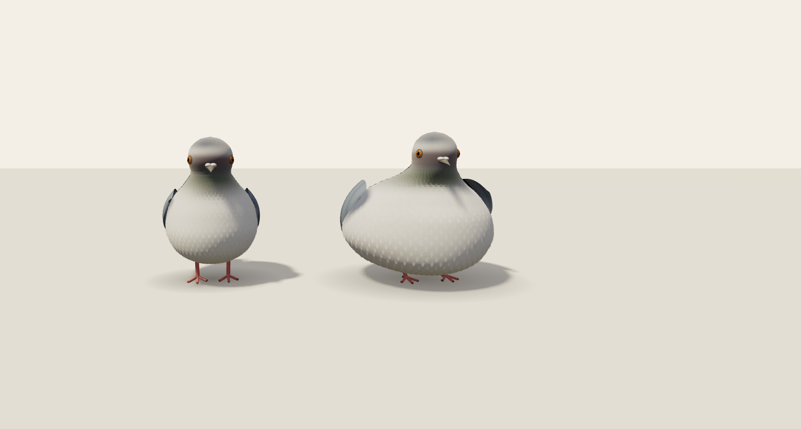

# 비둘기 모이주기 — 외형·재질 개선 v2

> 이전 v2 구현의 이력입니다. 현재 비둘기 우선 작업은 [v3 기록](MODEL-V3.md)을 참고하세요.

작업일: 2026-10-25 (한국 시간). 기준은 사용자 제공 명세 v1.0과 A+ 시안입니다. 사용자가 선택한 다음 산출물인 **일반 비둘기·닭둘기의 외형·재질 개선, 같은 빛에서의 정면·측면·먹는 자세 비교와 동작 검토**를 구현한 개선본입니다. 게임 전체 기능 완료와 구분합니다.

## 확인 방법

```sh
git pull --ff-only
npm ci
npm run dev
```

홈의 비둘기 카드에서 들어갑니다. ‘정면 비교 / 측면 비교 / 돌려보기’를 선택하면 왼쪽 일반형·오른쪽 닭둘기가 함께 나옵니다. ‘자세 시점’ 슬라이더는 일시정지하고 해당 포즈를 보여 줍니다. 비교 시점만 바꿀 때는 현재 동작 시점을 유지합니다. `/pigeon?view=front`, `?view=side`, `?view=turntable`로 바로 들어갈 수도 있습니다.

## 이전 구현에서 바꾼 부분

| 항목 | 이전 시제품 | v2 |
| --- | --- | --- |
| 몸통·목 | 겹친 구형·타원형 메시 | 서로 이어진 단일 곡면과 가중치 기반 목·머리 변형 |
| 닭둘기 | 기본 몸통 확대 | 더 넓고 낮은 배와 짧게 드러나는 다리, 별도 곡면 프로필 |
| 잔깃 | 크게 드러나는 반복 무늬 | 작은 곡면 깃과 미세한 색상·법선 텍스처 |
| 접힌 날개 | 수직으로 늘어진 조각 | 몸 옆면을 따르는 연속 덮깃 표면, 두 줄 무늬와 분리된 끝깃 |
| 눈·부리 | 두꺼운 눈 층과 큰 흰 부위 | 얇은 눈테·홍채 무늬·광택, 작은 납막과 가늘어진 부리 |
| 목 재질 | 단순 색 띠 | 완만한 녹색·보라색 전환과 부분적인 간섭색 재질 |
| 무게감 | 공통 보폭 | 닭둘기의 짧고 느린 보행, 더 큰 몸통 흔들림, 낮은 식사 자세 |
| 비교 | 공원 속 개체 선택 | 같은 빛의 두 체형, 정면·측면·회전, 시점 슬라이더 |
| 공원 | 큰 구형 잎 덩어리·균일한 바닥 | 작은 잎 인스턴스, 나뭇결, 바닥 요철·입자, 낮아진 카메라 |

## 실제 자산과 제작 방식

`src/assets/pigeon/normal-v2.glb`, `chicken-v2.glb`는 이 작업에서 직접 제작한 웹용 모델입니다. 다른 서비스에서 비둘기 모델을 가져오거나 시안 이미지를 배경으로 붙인 것이 아닙니다. 곡면 프로필, 스키닝, 깃·날개 형상과 텍스처를 작성한 뒤 Three.js GLTFExporter로 내보냈습니다. **Blender 수작업 조형이나 확보되지 않은 전문 자산으로 설명하지 않습니다.**

- 모델별 몸통·목·머리 관절, 피부 가중치, 눈·부리·날개·발·꼬리.
- 모델 파일 안에 색상·법선·홍채·부분 간섭색 텍스처와 `walk / eat / fly` 키프레임 포함.
- 날개는 접힌 곡면과 펼친 평면·끝깃 부채꼴 사이의 변형을 포함합니다. 관절 회전과 함께 끝깃이 한 표면에 붙어 펼쳐지며 이 변형의 애니메이션 채널도 GLB에 보존합니다.
- 런타임은 기존 시간 기반 포즈를 새 모델 관절에 연결합니다. GLB의 키프레임도 같은 포즈 생성기에서 내보냅니다.
- 일반형 41,828 삼각형 / 3,551,776 bytes, 닭둘기 44,324 삼각형 / 3,697,756 bytes. 비둘기 페이지 진입 때만 요청합니다.
- 화면의 작은 배경 개체는 잔깃 메시를 숨겨 렌더링 부담을 줄입니다.
- 페이지 이탈 시 로딩 취소, 관절별 복제 자원과 공유 메시·재질·이미지·WebGL 컨텍스트 정리.
- [자산·제작 소스 체크섬](v2/assets-manifest.json)은 `npm test`에서 확인합니다.

제작 소스를 바꾼 경우 `npm run assets:pigeon`으로 GLB를 다시 생성합니다. Playwright Chromium이 필요합니다. Linux 시스템 Chromium을 쓰려면 `PLAYWRIGHT_CHROMIUM_EXECUTABLE_PATH=/usr/bin/chromium npm run assets:pigeon`을 사용할 수 있습니다. 일반 실행과 빌드는 이미 보존된 GLB를 사용합니다.

## 사진과 동작 영상

최종 빌드의 실제 WebGL 렌더링입니다. 아래 모델 사진은 조작 패널을 잠시 숨긴 같은 캔버스를 캡처했습니다. 정적인 시안이나 생성 이미지를 실행 화면으로 표시하지 않습니다.



[측면 비교](v2/side-models.png) · [먹는 자세](v2/eating-models.png) · [비행·회전 관찰](v2/flight-models.png) · [공원](v2/park-models.png) · [조작 화면](v2/front.png)

[걷기·먹기·비행 검토 영상 — MP4](v2/motion-review.mp4) · [캡처·모델 체크섬 기록](v2/review-record.json)

영상 순서: 0–1.58초 걷기, 1.58–4.33초 먹기, 4.33–12.08초 비행과 회전 관찰. 브라우저에서 바로 재생되지 않으면 파일을 내려받아 열 수 있습니다. 로컬 클론의 `docs/pigeon/v2/motion-review.mp4`도 같은 파일입니다.

영상은 자세 슬라이더로 지정한 시뮬레이션 시점마다 실제 캔버스를 캡처하여 연결하는 검토용 자료입니다. 실시간 GPU 성능 측정 영상으로 설명하지 않습니다. 재생성은 프로덕션 미리보기 서버를 실행한 뒤 `node scripts/capture-pigeon-review.mjs`로 할 수 있으며 Playwright Chromium과 ffmpeg가 필요합니다.

## 검증과 남은 차이

검증 환경: Node 24.19.0, Chromium 154 headless / SwiftShader. 브라우저 자동 검사는 1440×1000 / DPR 0.5, 검토 사진은 1600×1000 / DPR 1입니다.

| 검사 | 결과 |
| --- | --- |
| `npm run source:check` | 원본 푸딩 17개 체크섬·생성 결과 일치 |
| `npm test` | **16 통과 / 0 실패** |
| 프로덕션 전체 회귀 E2E | **14 통과 / 0 실패** — 비둘기 6, 기존 플랫폼·푸딩 8 |
| 마지막 날개·끝깃 보정 후 최종 dist 비둘기 E2E | **6 통과 / 0 실패** |
| `npm run build` | 성공. 공유 Three.js 약 579 kB의 크기 경고는 남음 |
| 푸딩 원본·생성 엔진·음원 diff | 변경 없음 |
| 최종 캡처 | 모델 자산 체크섬 일치, 브라우저 예외·error 콘솔·외부 요청 0건 |
| 검토 영상 파일 | H.264 / 1200×680 / 12 FPS / 145프레임, 전체 디코딩 성공 |

모델 자산 체크섬·내장 이미지·관절·세 가지 클립·날개 변형 채널, 낮고 넓어진 닭둘기 체형, 실제 피부 정점의 유한값·바닥 침범, 부리·발 좌표, 비행 시 날개 방향·덮깃과 끝깃의 연결 평면을 검사합니다. 브라우저에서는 실제 GLB 로딩, 걷기·먹기·비행·착륙·정지·재개, 비교 시점·시점 조절, 손상된 파일의 오류 안내·재시도, 다운로드 중 홈 복귀와 재진입을 확인했습니다. 전체 회귀 검사의 뒤에 시각 검토에서 발견한 날개 보정을 적용하고 최종 dist에서 비둘기 6개를 다시 검사했습니다.

최초 개발 E2E에서는 공원에서 고개를 드는 시점 관측 한 건이 15초 제한을 초과했습니다. 분리 측정에서 소프트웨어 WebGL은 공원 8초 동안 17프레임·0.85 시뮬레이션 초, 두 모델 비교 장면에서는 45프레임·2.25 시뮬레이션 초가 진행했고 두 장면에서 실제 부리 높이 변화를 관측했습니다. 고정된 지연 상한 시계와 소프트웨어 렌더링 지연의 영향을 확인했습니다. 동작 검사는 비교 장면에서 고개 숙임·복귀 전체를 다시 통과했고 공원·자산 로딩·경로·재진입은 별도로 검사합니다. 이 측정은 실제 PC GPU의 프레임률을 뜻하지 않습니다.

목표 시안과 비교하면 잔털의 부드러움, 목과 눈 주변의 세부 조형·재질, 날개 관절·끝깃의 자연스러움, 식생과 배경의 밀도에 차이가 남습니다. 미술 품질의 최종 승인을 받은 상태로 표시하지 않습니다.

투척·자동 충전·섭취량·성장·퇴장·닭둘기 두 마리 제한·클릭 반응·싸움·연애·모이 부착·도감·사건·사운드는 이번 외형 개선 범위 이후의 작업입니다. 바닥 모이는 여전히 고정 장식입니다. 기존 푸딩 원본·음원과 배포된 Sites는 수정하지 않으며 Netlify 배포 보류를 유지합니다.
