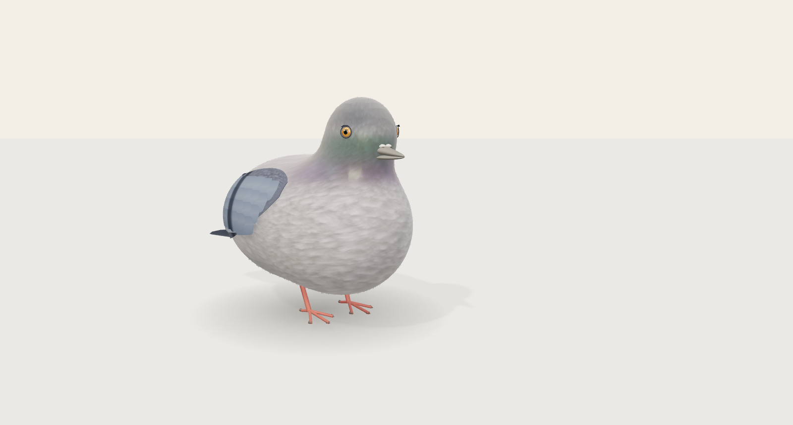
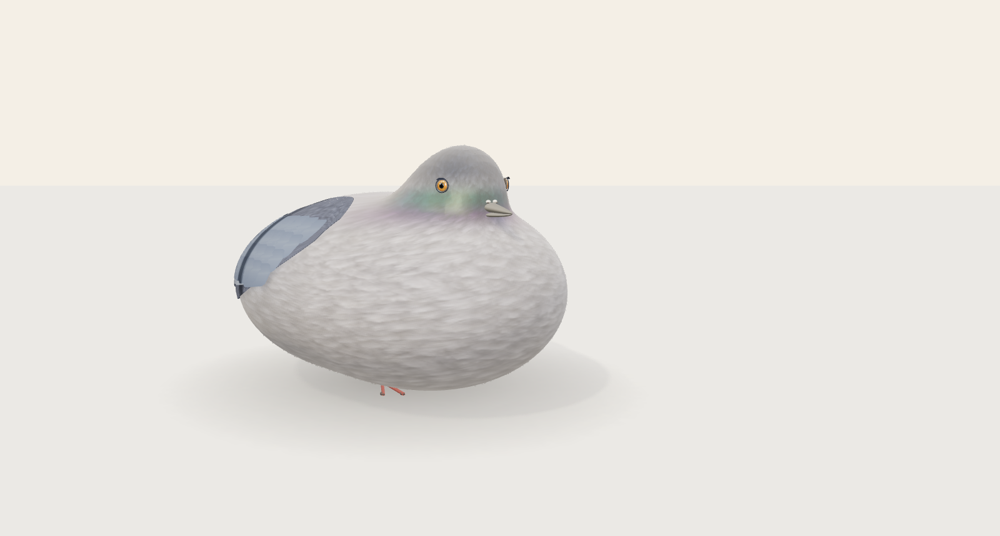
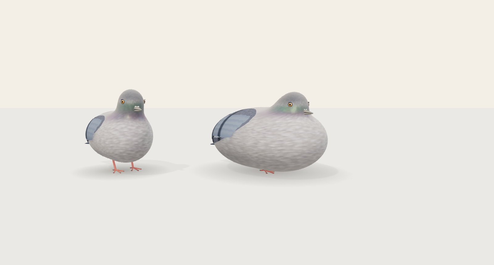

# 비둘기 우선 — 모델·기본 동작 v3

작업일: 2026-10-25. 사용자의 “비둘기 먼저 구현 완료하고 주변환경을 구현하자” 지시에 따라 **비둘기 두 체형과 기본 동작부터 검토하도록** 수정했습니다. 공원 제작 파일은 변경하지 않았습니다. 아래는 실제 구현과 남은 차이를 나눈 기록이며, 시안 수준의 미술 품질이나 게임 전체 완료를 뜻하지 않습니다.

## 직접 확인

프로젝트 루트에서 실행합니다. 이미 의존성을 설치했다면 `npm ci`는 생략할 수 있습니다.

```sh
git pull --ff-only
npm ci
npm run dev
```

터미널에 표시된 주소의 `/pigeon` 또는 홈의 비둘기 카드로 들어갑니다.

1. **일반 비둘기 / 닭둘기**를 선택합니다. 기본 화면은 한 마리를 크게 보여 줍니다.
2. **모델 보기 / 정면 비교 / 측면 비교 / 돌려보기**로 형태를 확인합니다.
3. **크기 비교**는 왼쪽 일반형·오른쪽 닭둘기를 함께 보여 줍니다.
4. **쉬기 / 걷기 / 먹기 / 날기**를 선택합니다. 쉬기에는 숨쉬기·고개 움직임·눈 깜박임이 있습니다.
5. ‘자세 시점’ 슬라이더로 멈춘 뒤 체형이나 시점만 바꿔 같은 자세를 비교합니다. 쉬기 3.5초 부근에서 눈꺼풀이 닫힙니다.

`/pigeon?view=front`, `?view=side`, `?view=pair`, `?view=turntable`로 직접 접근할 수 있습니다. 이전 공원은 `?view=park`에 보존했지만 이번 검토의 기본 화면과 버튼에서는 제외했습니다.

## 시안과 연결한 변경

| 기준 | v3 구현 | 남은 차이 |
| --- | --- | --- |
| 낮고 둥근 몸과 짧은 목 | 가슴·배·목·머리를 이어 조형, 두 체형을 별도 제작 | 먹기 자세에서 목·가슴 연결부의 늘어남과 재질 경계가 보임 |
| 바닥에 퍼지는 닭둘기 | 일반형보다 넓은 몸, 낮은 배와 짧게 드러나는 다리 | 시안의 풍성한 솜털 실루엣과 무게감에는 차이가 있음 |
| 부드러운 잔깃 | 회색 잔깃 바탕 텍스처, 미세한 표면 재질, 실제 작은 잔털 메시 | 텍스처는 실시간 개별 깃 시뮬레이션이 아니며 확대하면 반복과 경계가 보임 |
| 겹친 날개·큰 날림깃 | 몸 곡면에 붙는 덮깃, 분리된 날림깃·끝깃, 펼침 변형 | 접힌 깃의 배열이 규칙적이고 일부 경계·교차가 보이며 비행 관절 움직임은 단순함 |
| 주황 홍채와 살아 있는 눈 | 얇은 눈테·홍채 무늬·동공·광택, 실제 눈꺼풀 변형 | 시안의 사실적인 눈 주변 연조직 표현에는 미치지 못함 |
| 녹색·보라색 목 | 정점 색상과 부드러운 광택 마스크 | 시안보다 색과 빛의 변화가 약함 |
| 작은 생명체의 움직임 | 숨쉬기·깜박임, 교대 보행, 고개 숙임·부리 동작, 이륙·날갯짓·착륙 | 현재 동작 관찰용이며 자율적인 먹이 탐색·섭취 행동은 미구현 |

이번 시각 점검에서는 닭둘기 머리 곡면에 묻히던 눈을 표면에 맞춰 배치했고, 날개 깃의 폭이 표면 적용 과정에서 선처럼 눌리는 문제를 수정했습니다. 재질을 분리하던 목 경계는 하나의 연속 재질과 부드러운 마스크로 바꿨습니다. 날개 아래 잔털의 돌출과 먹기 중 등까지 꺾이던 관절 가중치를 수정하고, 비행 시 화면 밖으로 나가던 날개 끝도 보정했습니다.

## 실제 렌더링

아래는 최종 `dist`를 Chromium에서 실행해 캡처한 **실제 WebGL 캔버스**입니다. 모델 비교용 사진은 조작 패널을 잠시 숨겼습니다. 생성된 장면 이미지로 실행 결과를 대신하지 않습니다.







| 자세 | 일반 비둘기 | 닭둘기 |
| --- | --- | --- |
| 정면 | [사진](v3/normal-front.png) | [사진](v3/chicken-front.png) |
| 측면 | [사진](v3/normal-side.png) | [사진](v3/chicken-side.png) |
| 먹기 | [사진](v3/normal-eating.png) | [사진](v3/chicken-eating.png) |
| 날개 펼침 | [사진](v3/normal-flight.png) | [사진](v3/chicken-flight.png) |

[실제 조작 화면](v3/controls.png) · [두 체형 동작 검토 영상 — MP4](v3/motion-review.mp4) · [캡처 기록](v3/review-record.json)

영상은 **17.33초 / 208프레임 / H.264 / 1200×680**이며, 쉬기(0–5.25초)·걷기(5.25–6.83초)·먹기(6.83–9.58초)·날기(9.58–17.33초) 순서로 실제 캔버스를 12 FPS로 샘플링한 자세 검토 자료입니다. 실시간 PC GPU 성능 측정 영상으로 설명하지 않습니다. 브라우저에서 재생되지 않으면 파일을 내려받거나 로컬 클론의 `docs/pigeon/v3/motion-review.mp4`를 열 수 있습니다.

## 제작 소스와 자산

외부에서 받은 원본 3D 모델은 없습니다. 저장소의 제작 소스로 곡면 메시·피부 가중치·잔털·날개·얼굴·발을 작성해 GLB로 내보냈습니다. Blender 수작업 조형이나 제공된 시안의 원본 자산으로 설명하지 않습니다.

**회색 잔깃 바탕 텍스처는 OpenAI image_gen으로 제작했습니다.** [출처 설명과 생성 지시](../../scripts/pigeon-assets/textures/PROVENANCE.md), [수정하지 않은 생성 원본 PNG](../../scripts/pigeon-assets/textures/feather-albedo.png)를 보존했습니다. 이는 실제 메시의 색상 맵이며, 시안에서 추출한 텍스처나 실제 사진이 아닙니다. 몸통·머리·목의 색은 정점 색상으로 적용합니다. 내보내기 시 웹용 이미지 해상도를 제한합니다.

| 자산 | 삼각형 | 크기 |
| --- | --- | --- |
| `normal-v3.glb` | 48,119 | 6,119,596 bytes |
| `chicken-v3.glb` | 59,531 | 6,978,492 bytes |

각 파일에 텍스처·관절·피부 가중치·눈꺼풀과 날개 변형·`idle / walk / eat / fly` 클립이 포함됩니다. 런타임과 내보낸 클립은 같은 포즈 생성기를 사용합니다. GLB 클립은 관절 자세를 담고, 개체의 이동 궤적은 장면에서 적용합니다. 관찰 화면은 위치·시점을 고정해 자세를 보여 주며, 비행의 높이는 반영합니다. 비둘기 페이지 진입 때만 두 파일을 요청하며, GLB 안에 외부 이미지 URL은 없습니다. [자산과 제작 소스 SHA-256](../../src/assets/pigeon/manifest.json)은 단위 검사에서 대조합니다. 이전 v2 GLB는 이력으로 보존하고 현재 빌드에는 포함하지 않습니다.

```sh
# 모델 제작 소스를 바꿨을 때만 자산 재생성
PLAYWRIGHT_CHROMIUM_EXECUTABLE_PATH=/usr/bin/chromium npm run assets:pigeon

# 검토 자료 재생성: 먼저 빌드와 preview 서버 실행
npm run build
npm run preview -- --port 4174 --strictPort
# 다른 터미널에서
PLAYWRIGHT_CHROMIUM_EXECUTABLE_PATH=/usr/bin/chromium node scripts/capture-pigeon-v3.mjs
```

핵심 소스: `scripts/pigeon-assets/anatomy.mjs`(조형·피부), `wings.mjs`(날개), `face.mjs`(얼굴), `materials.mjs`(재질), `src/features/pigeon/rig.js`(관절), `motion.js`(동작), `scene.js`(관찰 화면).

## 검증

검증 환경: Node 24.19.0, Chromium 154 headless / SwiftShader. 브라우저 자동 검사는 1440×1000 / DPR 0.5, 사진은 1600×1000 / DPR 1입니다. 실제 PC GPU의 프레임률이나 시안 수준의 미술 품질을 이 결과로 보장하지 않습니다.

| 검사 | 결과 |
| --- | --- |
| `npm run source:check` | 원본 푸딩 17개 파일 체크섬과 생성 JS/CSS 일치 |
| `npm test` | **16 통과 / 0 실패** |
| `npm run build` | 성공. 공유 Three.js 약 581 kB의 청크 크기 경고는 남음 |
| 최종 `dist` 전체 E2E | **14 통과 / 0 실패** — 비둘기 6, 기존 플랫폼·푸딩 8 |
| 최종 캡처 | 사진 12개, 페이지 예외·error 콘솔·외부 요청 0건 |
| 자산 일치 | 제작 소스·GLB·실제 dist GLB·캡처 기록 SHA-256 대조 |
| 검토 영상 | 208프레임 / 17.33초 / 12 FPS, 전체 디코딩 성공 |
| 공원·푸딩·원본 음원·배포 설정 diff | 변경 없음 |

단위 검사에서는 자산 체크섬·내장 이미지·네 가지 클립과 변형 채널, 두 체형의 크기 차이, 실제 피부 정점의 유한값·바닥 침범·등 변형, 머리 표면 위의 홍채, 눈꺼풀 닫힘, 깃 면적과 펼친 날개의 연결, 실제 부리·발 좌표를 확인합니다.

브라우저에서는 기본 모델 화면, 일반형·닭둘기 전환, 걷기·고개 숙임과 복귀·이륙·날갯짓·착륙·정지·재개·리셋, 같은 시점으로 멈춘 상태의 체형 전환, 직접 진입·새로고침·홈 복귀와 반복 진입을 확인했습니다. 손상된 파일의 오류 안내·재시도와 다운로드 중 이탈도 검사합니다. 기존 푸딩의 변형·손/양푼/채찍 판정·맛과 설정·터치·실제 오디오 출력/중첩/볼륨·페이지 이탈 시 정리도 최종 dist에서 통과했습니다.

## 다음 범위

시안과의 미술 품질 차이는 위 표에 남겼습니다. **이번 결과를 시안 재현 완료로 표시하지 않습니다.** 비둘기 검토 이후 주변환경을 진행할 순서이며, 공원 제작 소스는 이번 변경에서 그대로 유지했습니다.

전체 [기능 명세](pigeon_feeding_spec_v1.0.md)의 모이 투척·자동 충전·실제 섭취·성장·퇴장·닭둘기 수 제한·클릭 반응·싸움·화해·연애·부위별 부착·도감·사건·사운드는 아직 구현하지 않았습니다. 기존 푸딩 소스·음원과 배포된 Sites는 변경하지 않았습니다. GitHub는 `poosuck/All_sorts_of_nonsense`를 사용하고 **Netlify 배포는 보류**합니다.
