# 명세서 기반 v4 구조 재구성 검수

기준 명세: [MODEL-REVISION-SPEC.ko.md](MODEL-REVISION-SPEC.ko.md) · 수정 전: `5901c7c` · 작업 브랜치: `codex/pigeon-stylized-reference`

이 결과는 명세서의 큰 형태·날개 부착·방향을 우선 수정한 **구조 재구성 검수본**이다. 사용자가 제공한 참고 이미지와 같은 미세 디테일까지 모두 완료했다는 의미가 아니다. 아래에서 구조 검사와 남은 외형 차이를 구분한다.

## 구현 변경

- 일반 비둘기의 몸통·목·머리와 날개를 별도의 작업용 형상으로 재제작했다. 이전 kenchoo 메시 표면에 깃털 패치를 투영하던 방식은 기본 일반 비둘기에서 사용하지 않는다.
- 몸통은 타원체를 매끄럽게 연결한 폐곡면이다. 짧은 목과 둥근 머리를 연결하고 몸통 뒤쪽·배·가슴을 하나의 볼륨으로 만들었다.
- 날개는 어깨 기부와 접힌 기본 면, 윗덮깃, 아랫덮깃, 긴 비행깃으로 구성한다. 깃털은 날개 좌표계에서 뒤쪽으로 자라고 어깨에서 뒤로 갈수록 커진다.
- 접힌 면과 펼친 면은 같은 토폴로지를 공유하며 중간 자세를 보간한다. 펼친 날개의 바깥쪽은 긴 비행깃이 부채 형태로 벌어진다.
- 볼록한 중앙보다 얇은 층의 높이 차로 겹침을 표현한다. 앞 깃털의 끝을 뒤 깃털 중앙이 뚫고 올라오는 문제를 층 간격과 곡률 조정으로 완화했다.
- 두 줄의 검은 띠는 덮깃 열과 함께 움직인다. 직선 색 절단 대신 깃털의 둥근 끝이 띠의 경계를 만든다.
- 목·가슴에는 방향을 가진 짧은 깃털 형상과 얕은 요철을 추가했다. 이전의 규칙적인 수평 비늘 셰이더는 새 기본 모델에서 사용하지 않는다.
- 먹는 자세에서 목 변형이 등 쪽에 깊은 틈을 만들던 문제를 닫힌 몸통 볼륨과 몸통용 깃털로 보정했다.
- 주황 홍채·동공·납막·짧은 부리, 발가락 관절, 분리된 꼬리깃을 추가했다.
- 체형 슬라이더·걷기·먹기·눈 깜박임·접힘·비행·종류 전환을 기존 페이지에 연결했다. 닭둘기는 기존 v3를 유지한다.

새 일반 비둘기는 런타임에서 생성하는 형상이다. kenchoo 원본 glTF·텍스처·라이선스와 기존 일반 비둘기 GLB는 삭제하거나 덮어쓰지 않았다. 기존 원본 모델을 살펴보는 별도 기능과 자산은 보존한다. 새 모델에 사용하지 않는 원본 모델을 기본 페이지에서 추가 다운로드하지 않는다. UI에는 실제 선택 모델이 `참고 이미지 기반 비둘기 v4`로 표시된다.

## 비교 조건

- 원래 페이지의 조명·노출·환경광·그림자 설정은 바꾸지 않았다.
- 기본 비교는 1200×850, 같은 페이지 카메라·체형 82·중립 시점 0이다.
- 같은 페이지 카메라의 전체 캡처는 `*-page.png`, UI를 숨겨 모델 부분만 자른 이미지는 `.png`로 저장한다. 비행 프레임은 날개 끝과 착륙 자세가 잘리지 않도록 더 넓은 세로 영역을 사용한다.
- 위·뒤와 방향 표시 이미지는 URL의 검수 전용 카메라/재질 옵션을 사용한다. 기본 카메라의 전후 비교와 혼동하지 않는다.
- 먹기·비행·접힘은 실제 페이지의 시간 슬라이더로 자세를 고정했다. 클릭만 하고 동작을 검증했다고 처리하지 않았다.
- 브라우저·시점·시간·모델 식별자·오류 기록은 [review-record.json](reference-v4/review-record.json)에 있다.

## 수정 전·후

두 페이지 캡처는 같은 크기로 비교한다. 모델 소스와 형상은 변경됐고, 조명과 기본 카메라는 유지됐다.

| 수정 전 `5901c7c` | 구조 재구성 후 |
| --- | --- |
| 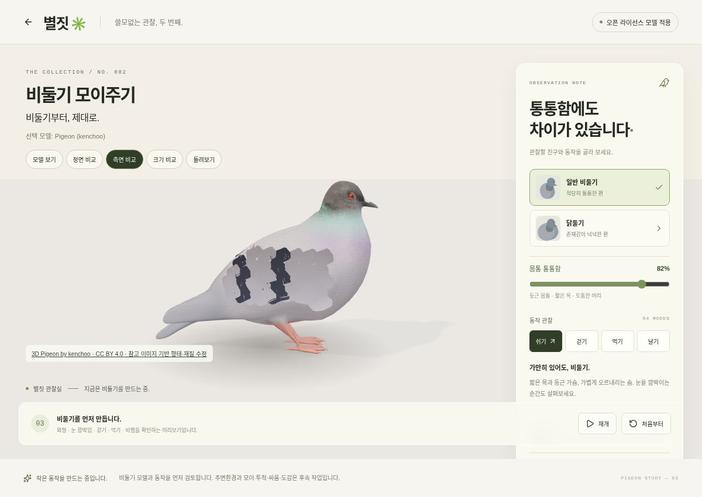 | 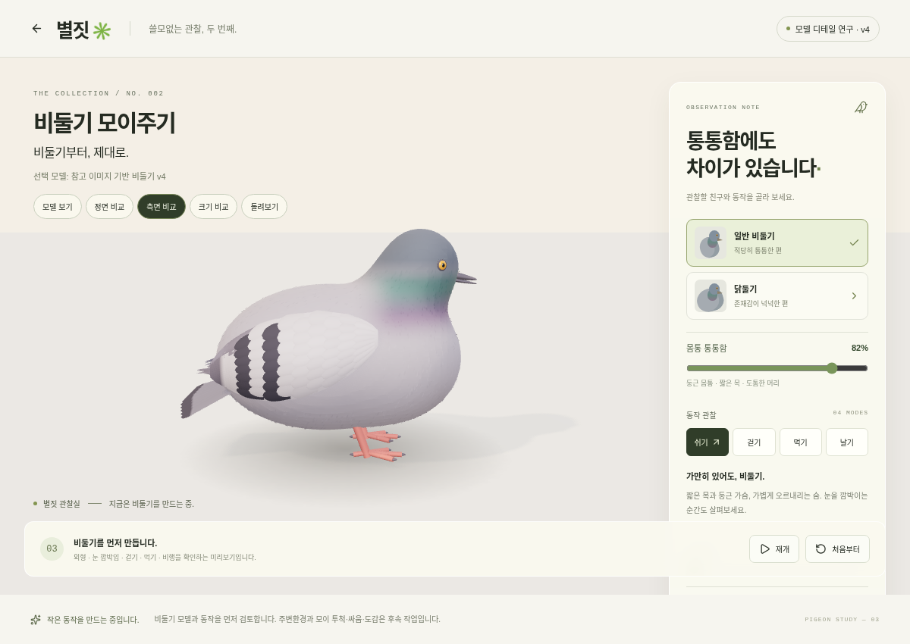 |
| 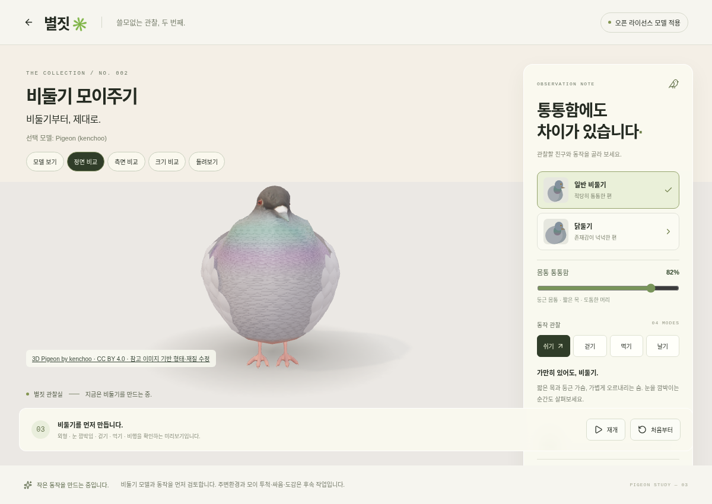 | 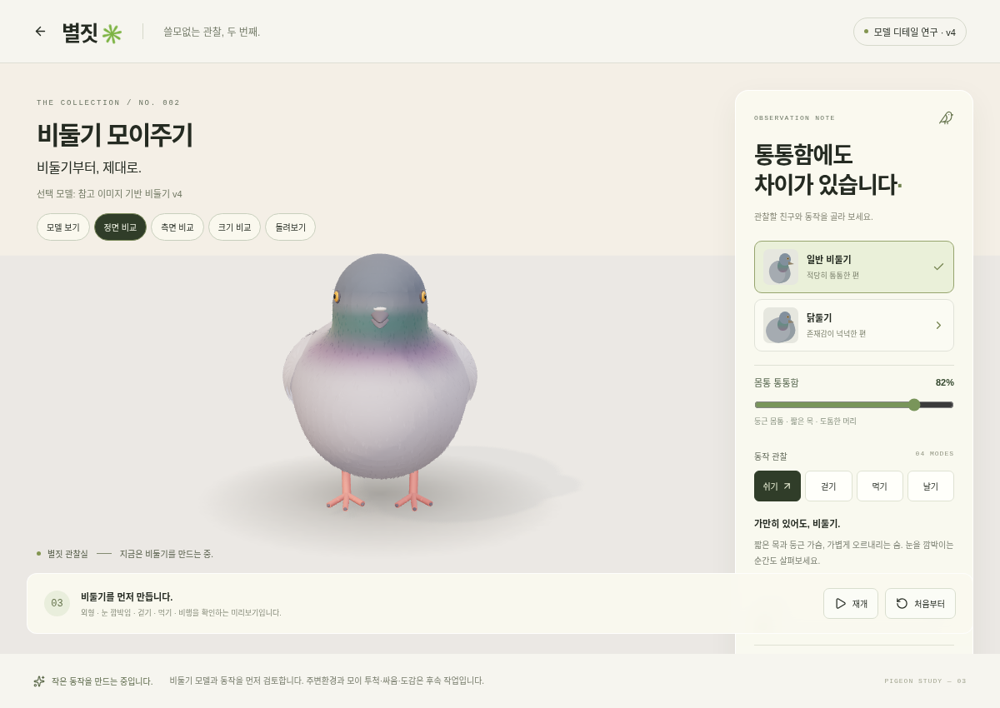 |

## 기본 형태·방향 검수

| 단색 측면 | 단색 정면 | 날개 방향 표시 |
| --- | --- | --- |
| 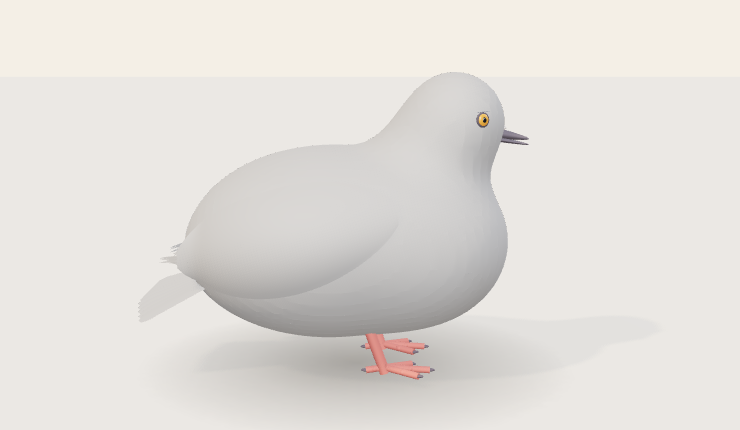 | 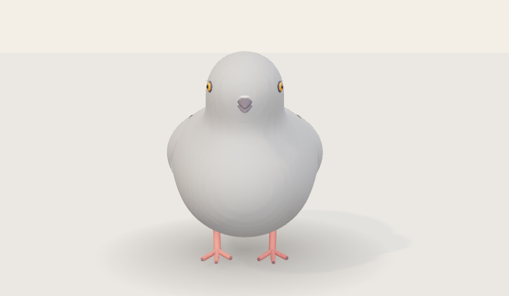 | 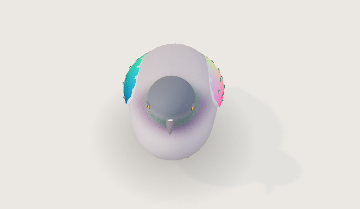 |

## 렌더링

| 측면 | 정면 | 사선 |
| --- | --- | --- |
| 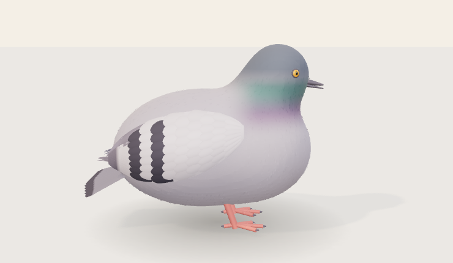 | 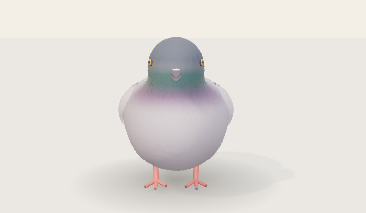 | 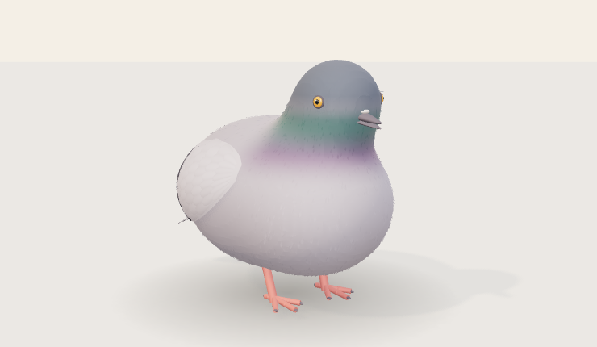 |

| 위쪽 사선 | 후면 | 먹는 자세 |
| --- | --- | --- |
| 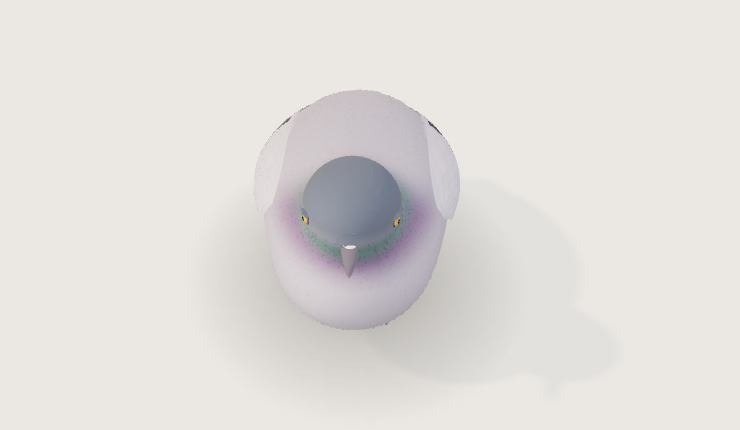 | 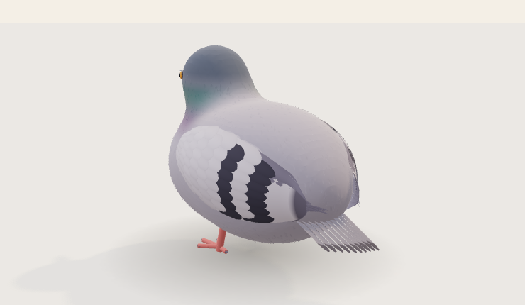 | 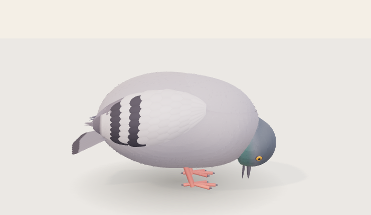 |

## 날개 접힘·펼침 연속 프레임

동일한 비행 동작을 시간 슬라이더로 샘플링한 실제 WebGL 프레임이다. 실시간 재생 FPS를 측정한 영상이 아니다. 비행 시에는 기존 페이지가 자동으로 카메라 거리를 바꾸므로, 중립 자세 캡처와 화면상의 절대 크기를 비교하지 않는다.

| 0.00초 | 0.20초 | 0.50초 | 1.15초 |
| --- | --- | --- | --- |
|  |  | 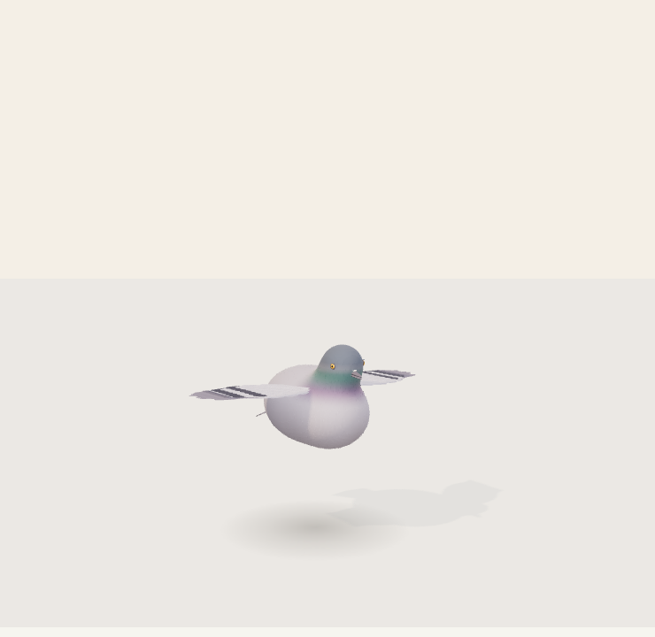 | 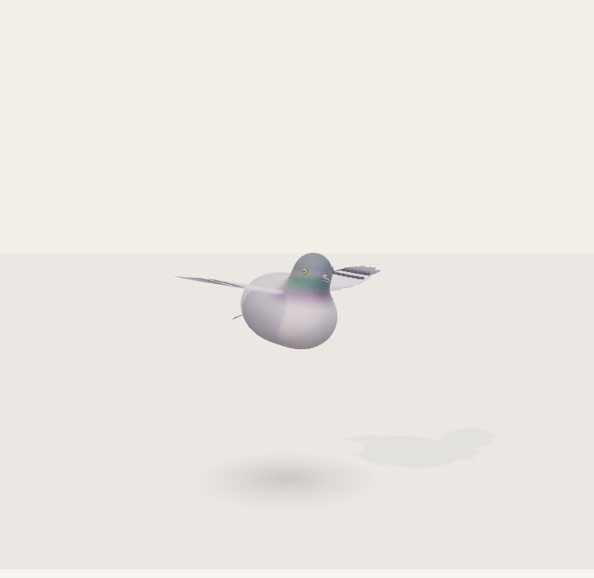 |

| 2.40초 | 6.50초 | 6.80초 | 7.10초 |
| --- | --- | --- | --- |
| 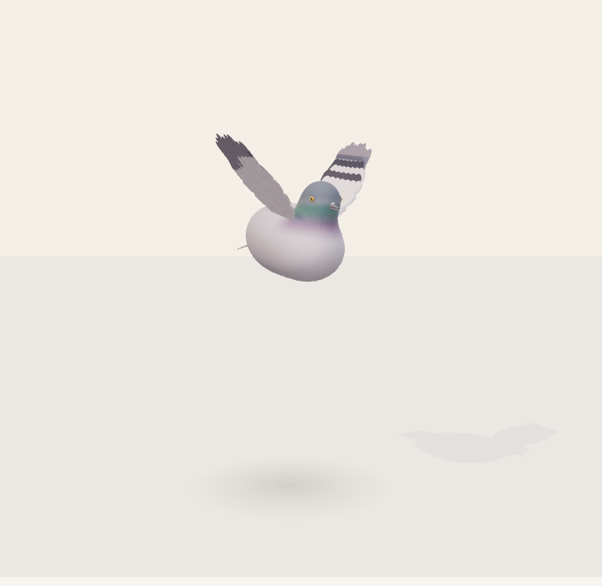 | 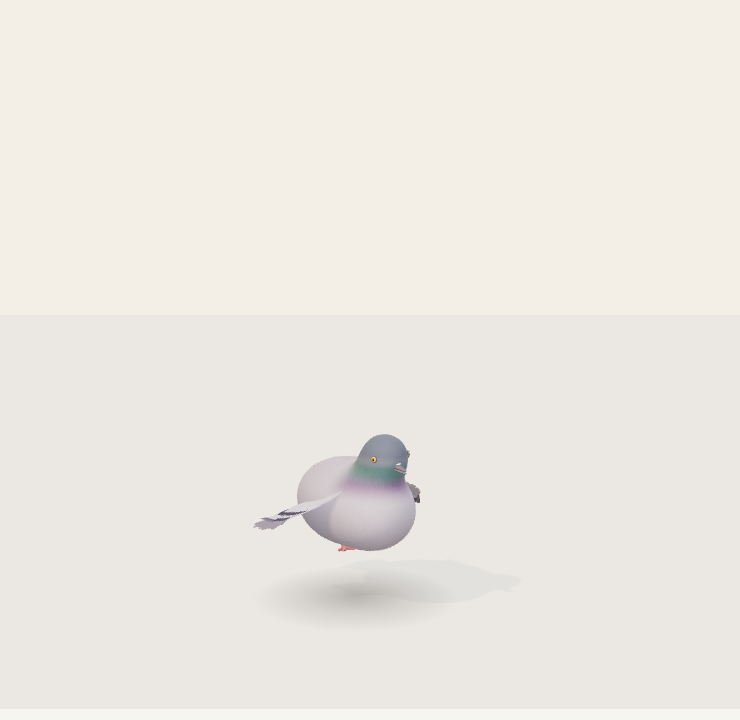 |  | 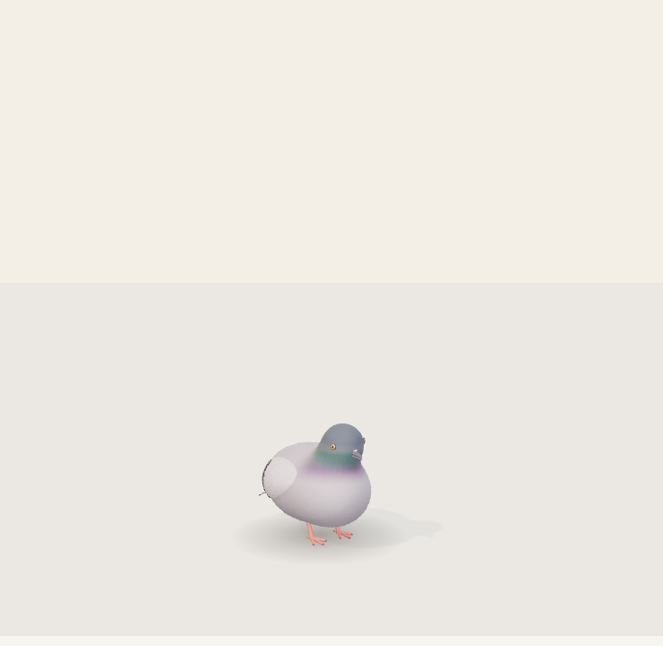 |

## 요구사항별 판정

`통과`는 해당 구조·동작 기준을 렌더링에서 확인했다는 뜻이다. 참고 이미지와 모든 비율·표면이 동일하다는 뜻은 아니다. `미통과`는 명세서의 최종 외형 기준에서 남은 차이가 있다는 뜻으로, 최종 완료에 포함하지 않는다.

| ID | 판정 | 확인 근거 / 남은 차이 |
| --- | --- | --- |
| BODY-01 | 통과 | 단색 측면·정면에서 가슴·배·뒤 몸통이 연결된 타원으로 읽힌다. 가늘고 긴 뒤 몸통을 제거했다. |
| BODY-02 | 통과 | 둥근 머리와 짧은 목을 연결했고, 먹기에서 등의 깊은 틈을 보정했다. |
| WING-01 | 통과 | 몸통 위의 패치 대신 접힌 날개 기본 면과 기부를 만들었다. |
| WING-02 | 통과 | 위·앞·아래·뒤 경계를 정면·측면·위·후면에서 확인했다. 앞가슴을 덮던 세로 겹깃을 없앴다. |
| WING-03 | 통과 | 안팎 덮깃과 긴 비행깃을 구분하고, 접기·펼치기의 연결을 연속 프레임에서 확인했다. 펼친 날개의 미술적 디테일은 더 다듬을 수 있다. |
| FEATHER-01 | 통과 | 날개 좌표계의 뒤쪽 흐름과 몸통 곡면의 아래·뒤 흐름을 적용했다. 방향 표시 캡처로 확인했다. |
| FEATHER-02 | 통과 | 작은 어깨 덮깃에서 큰 덮깃·긴 비행깃으로 크기 단계를 나눴다. |
| FEATHER-03 | 미통과 | 뿌리를 숨기고 얇은 끝을 만들었지만, 일부 끝과 띠 경계가 참고 이미지보다 규칙적이다. |
| FEATHER-04 | 통과 | 중앙의 큰 부풀음을 줄이고 층 순서와 간격을 정리했다. 체형·접힘 중 표면 연결을 확인했다. |
| FEATHER-05 | 미통과 | 두 띠의 끊김·교차는 줄었지만 참고 이미지의 자연스러운 폭 변화와 깃털별 경계에는 차이가 남는다. |
| SURFACE-01 | 미통과 | 반복 비늘무늬를 제거했으나, 참고의 조밀하고 납작한 가슴·배 깃털보다 표현이 성기고 단순하다. |
| SURFACE-02 | 미통과 | 목에 작은 깃털을 추가했지만 청록·보라의 경계와 깃털별 색 분산은 더 다듬어야 한다. |
| SURFACE-03 | 미통과 | 원본 실사 머리·비늘 몸통·큰 패치의 혼용은 제거했다. 목표의 전체적인 표면 밀도와 형태 일관성까지는 추가 조정이 필요하다. |
| DETAIL-01 | 미통과 | 개별 꼬리깃과 둥근 끝을 만들었지만 후면에서 겹침과 벌어짐이 아직 규칙적이다. |
| DETAIL-02 | 통과 | 주황 홍채·동공·납막·부리를 구분하고 눈이 묻히지 않는지 확인했다. |
| DETAIL-03 | 미통과 | 짧은 다리·도톰한 발가락·관절·발톱은 적용했지만 미세한 비늘·주름은 단순하다. |

P0 구조 항목을 우선 확인한 검수본이다. P1에서 미통과인 외형 항목이 남아 있으므로 **명세서 전체 완료로 판정하지 않는다**. 다음 수정은 이 표의 미통과 항목을 기준으로 진행한다.

## 기술 검증

- 단위 테스트: 23개 통과. 깃털 면 방향과 노멀 일치, 단색·방향 표시 검수 모드의 생성·해제를 포함한다.
- 프로덕션 빌드: 통과.
- 페이지 브라우저 테스트: 6개 항목 확인. 첫 실행에서 슬라이더의 0.05초 반올림 때문에 0.18초 고정 검사가 실패했고, 검수용 입력의 step을 정리한 뒤 해당 동작 검사를 재실행해 통과했다. 다른 5개 검사는 통과했다.
- 비교 캡처의 페이지·콘솔·셰이더 오류: `review-record.json`의 `errors` 배열로 확인한다.
- 0·82·100 체형 값, 먹기, 접힘·펼침, 착륙 후 상태를 캡처했다.
- 실시간 GPU 성능과 모든 가능한 자세의 무관통을 보증하는 검사는 아니다.

## 로컬 확인과 재현

```sh
git fetch origin
git switch codex/pigeon-stylized-reference
git pull --ff-only
npm ci
npm run dev
```

브라우저에서 `/pigeon`에 접속한다. 화면의 선택 모델이 `참고 이미지 기반 비둘기 v4`인지 확인한다. 원본 모델이나 기존 v3가 표시된다면 다른 브랜치/서버를 보고 있는 것이다.

검수 캡처를 다시 생성하려면 개발 서버를 실행한 상태에서:

```sh
PLAYWRIGHT_CHROMIUM_EXECUTABLE_PATH=/path/to/chromium node scripts/capture-pigeon-reference.mjs
```

Playwright 기본 Chromium이 설치된 환경은 실행 파일 환경변수 없이 실행할 수 있다. 다른 포트는 `REVIEW_BASE_URL`, 다른 결과 폴더는 `REFERENCE_REVIEW_OUTPUT`으로 지정한다.

검수 전용 URL:

- `/pigeon?pigeon-review=clay`: 단색 기본 형태.
- `/pigeon?pigeon-review=flow&pigeon-camera=top`: 날개 방향 표시.
- `/pigeon?pigeon-camera=top`: 위쪽 사선.
- `/pigeon?pigeon-camera=back`: 후면.
