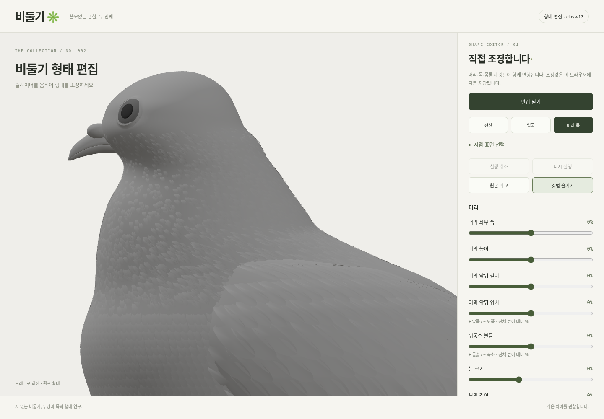

# 비둘기 직접 편집

[설치 없이 실행하는 ZIP 다운로드](https://raw.githubusercontent.com/poosuck/All_sorts_of_nonsense/codex/pigeon-clay-v1/downloads/pigeon-editor.zip)

ZIP을 **압축 해제**하고 `pigeon-editor.html`을 Chrome 또는 Edge에서 여세요. 모델·프로그램이 HTML 안에 들어 있어 Node.js, Blender, 로컬 서버, 인터넷 연결이 필요 없습니다. 오른쪽 패널을 아래로 스크롤하면 목·몸통 조정과 저장 버튼이 있습니다.



## 조작

- 마우스로 드래그하면 회전하고 휠로 확대합니다. **전신 / 얼굴 / 머리·목**으로 확대 범위를 선택합니다. **시점·표면 선택**을 펼치면 8방향과 무채색·기존색을 선택할 수 있습니다.
- **머리**: 좌우 폭, 높이, 앞뒤 길이, 앞뒤 위치, 뒤통수 볼륨, 눈 크기, 부리 길이.
- **목과 몸통 연결**: 목 좌우 폭, 뒷목 볼륨, 턱 아래·앞목, 가슴 볼륨.
- **몸통**: 좌우 폭과 앞뒤 길이. 발의 접지는 유지합니다.
- **원본 비교**는 원본을 임시 표시합니다. 조정값은 보존하며 **수정본 보기**로 돌아옵니다.
- **실행 취소 / 다시 실행**과 Ctrl/Cmd+Z, Ctrl/Cmd+Shift+Z를 지원합니다. 슬라이더에 초점을 둔 상태에서는 방향키로 값을 조정합니다.
- **깃털 숨기기**는 표면 아래의 기본 형태를 보는 옵션입니다.
- **참고 이미지 열기**로 PC의 PNG·JPG·WebP를 옆에 표시합니다. 서버 전송 없이 이 창에서만 열며, 새로고침하면 다시 선택해야 합니다.

비율을 조정하는 도구입니다. 정점 단위 조각이나 깃털 개별 편집은 Blender에서 진행하세요. 극단적인 조정값을 동시에 사용하면 표면이 눌리거나 부위가 겹칠 수 있습니다. 8방향으로 확인하며 조정하세요.

## 저장과 이어서 작업

**조정값 JSON 저장**으로 수치를 파일로 보관하고 **조정값 불러오기**로 이어서 작업합니다. 이 파일을 공유하면 동일한 기준 모델에서 형태를 재현할 수 있습니다. 다른 모델 버전의 JSON은 적용하지 않습니다.

조정값은 모델 해시별로 이 브라우저에 자동 저장됩니다. 브라우저 데이터 삭제, 다른 PC·브라우저 사용, 로컬 HTML 위치 변경 시에는 자동 저장값이 이어지지 않을 수 있으므로 **JSON을 내려받아 보관하세요.** 브라우저가 로컬 저장을 차단하면 화면에 안내합니다.

**수정 모델 GLB 저장**은 실제 변형된 메시를 내보냅니다. 모든 깃털과 기존 색상 재질을 포함하며, 무채색 보기·깃털 숨기기 여부는 GLB에 영향을 주지 않습니다. 원본 비교 중에는 수정 모델 저장을 비활성화합니다. Blender에서는 **파일 → 가져오기 → glTF 2.0 (.glb/.gltf)** 로 여세요.

**현재 화면 PNG 저장**은 현재 시점·표면·깃털 표시 상태의 모델 화면을 내보냅니다. 편집 패널과 참고 이미지는 포함하지 않습니다.

원본 `pigeon.blend`, `profiles.json`, 기준 GLB는 이 편집기로 덮어쓰지 않습니다. 내보낸 GLB는 수정한 실제 메시이며, Blender 제작용 단면 프로파일이나 리그를 자동 생성하는 파일은 아닙니다.

## 기존 프로젝트에서 실행

작업 브랜치 `codex/pigeon-clay-v1`을 받거나 갱신한 프로젝트 루트에서:

```sh
npm ci
npm run dev
```

http://localhost:5173/pigeon?edit=1 에서 동일한 편집기를 엽니다. `/pigeon`의 **직접 형태 조정하기** 버튼으로도 진입합니다. 관찰 화면은 원본을 표시하고, 편집 화면을 열면 저장된 조정값을 적용합니다.

## 구현과 검증

기준 모델은 **clay-v13**입니다. 저장된 원본 정점을 기준으로 연속 변형장을 계산해 몸통·머리·깃털을 함께 이동시킵니다. 같은 조정값을 반복해도 변형이 누적되지 않고 0으로 되돌리면 원본 정점과 노멀을 복원합니다. 눈과 부리의 전용 조정도 함께 지원합니다.

프로덕션 브라우저 검사 6개와 단위 검사, 빌드, 기존 푸딩 소스 무결성 검사를 통과했습니다. 단독 HTML은 외부 리소스 없이 오프라인으로 편집·초기화·자동 저장·GLB 내보내기를 확인했습니다. 내려받은 GLB의 실제 두상 정점 높이 변화와 48개 메시·깃털 포함을 검사했습니다.

관리형 Chromium은 `file://` 접근을 차단하므로 이 환경에서는 HTML 내용을 로컬 주소에 직접 제공해 검증했습니다. 파일을 더블 클릭하는 경로 자체는 이 환경에서 검사하지 못했습니다. [단독 실행판 검증·해시](verification.json)

단독 ZIP 재생성은 Node.js 24와 Python 3가 있는 환경에서 `npm run pigeon:editor`, 검사에는 Chromium을 준비한 뒤 `node scripts/verify-pigeon-editor.mjs`를 사용합니다. 변경한 소스와 ZIP을 함께 갱신하세요.
