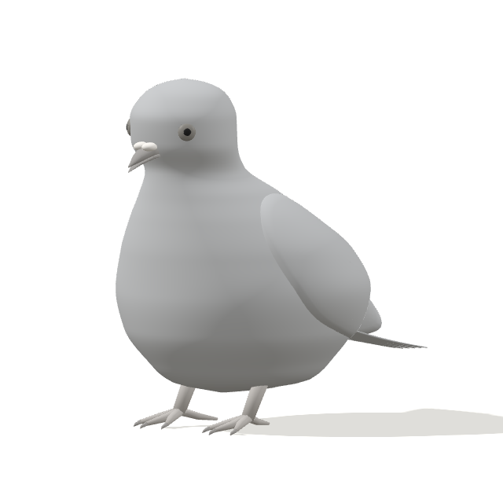
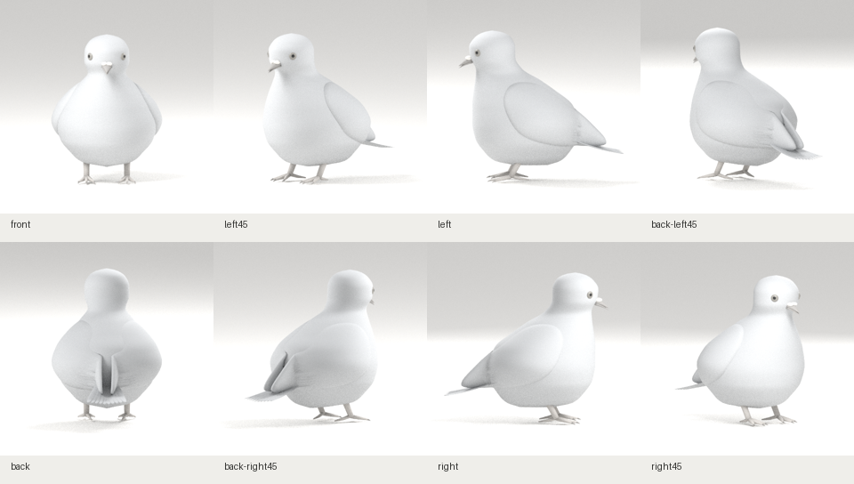

# 새 R01 체형 초안 · clay-v1

2026-10-29 작성. 이 기록은 **첫 체형 초안과 Blender → GLB → 웹 경로**의 검증 결과다. 깃털·재질·7종 자세까지 완성했다는 뜻은 아니다.

## 실제 결과





## 생성과 검증

- [실행 기록](https://github.com/poosuck/All_sorts_of_nonsense/actions/runs/40804445768) · 생성 소스 커밋 `96fb96cda8cfea86e64441c9392b6690182e3ffb`
- Blender 4.0.2, 원본 [pigeon.blend](../../../../art/pigeon/pigeon.blend), 배포 [pigeon.glb](../../../../src/assets/pigeon/pigeon.glb)
- GLB 509,672 bytes, 삼각형 26,308개, 메시 37개
- GLB SHA-256: `dfedea75d1aab93255121c3c5e13f1844d7708cbf6f330840fed7cb1160c8377`
- Blender 원본 SHA-256: `41139bdbfcba6310bcb56938f86941cdedf6c80ff75200510f992a1bb10eca3e`
- 실제 모델의 폭/H 0.739, 길이/H 1.099. 이 값은 **제작 모델 측정값**이며 참고 시트의 실측값이 아니다.
- [도구 검사](tools.json) · [모델 기록](model-report.json) · [웹 캡처 기록](web-report.json)

| 검사 | 결과 |
|---|---|
| 자체 Blender 메시·스킨·애니메이션 내보내기와 재가져오기 샘플 | 통과. 비둘기 리그 구현 완료를 뜻하지 않음 |
| 새 체형 제작과 Blender 8방향 렌더 | 통과 |
| 프로젝트 빌드 | 통과 |
| 단위 검사 | 13건 통과 |
| 푸딩 원본 일치 검사 | 통과 |
| 비둘기 프로덕션 Chromium E2E | 4건 통과: 8방향 전환, 손상 모델 재시도, 로딩 중 이탈, 좁은 화면·이전 검증실 제거 |
| 실제 웹 캡처 | 8방향. 같은 GLB 요청 1회, 페이지 예외 0건 |

## 웹의 8방향

| 시점 | 실제 캡처 |
|---|---|
| 정면 | [web-front.png](web-front.png) |
| 좌측 45° | [web-left45.png](web-left45.png) |
| 좌측면 | [web-left.png](web-left.png) |
| 후면 좌측 45° | [web-back-left45.png](web-back-left45.png) |
| 후면 | [web-back.png](web-back.png) |
| 후면 우측 45° | [web-back-right45.png](web-back-right45.png) |
| 우측면 | [web-right.png](web-right.png) |
| 우측 45° | [web-right45.png](web-right45.png) |

나머지 Blender 개별 캡처까지 포함한 전체 실행 산출물은 실행 페이지의 `pigeon-clay-model` 아티팩트에 있다. 아티팩트 보존 기간은 7일이며, 이 문서에서 링크한 캡처와 원본·GLB는 별도 보관 대상이다.

## 외형 관찰과 남은 차이

1. 머리 폭과 긴 발을 첫 생성 결과에서 조정했다. 현재 몸통·목·머리는 연속 단면으로 만든 표면이다.
2. 웹의 거친 자기 그림자와 눈 돌출을 실제 캡처에서 발견해 수정했다. Blender와 웹의 조명은 다르며, 최종 재질 일치를 판정한 단계는 아니다.
3. 날개는 위치·두께를 확인하는 매끈한 외피다. 목표 시트의 어깨 덮깃, 층별 겹깃과 긴깃 배열은 아직 없다. 후면 날개 끝의 가늘고 모이는 형태도 깃 구조 제작 시 조정해야 한다.
4. 머리·목·가슴의 깃털 결, 주황 홍채와 정교한 눈테, 최종 납막·발 디테일, 목의 청록·보라 광택은 남아 있다.
5. 서기 1종만 제공한다. 비둘기의 리그·7종 자세·연속 애니메이션은 미구현이다.
6. R01 이미지 원본은 저장소에 없어 비율은 화면을 보고 잡은 초기 추정값이다. 원본 파일 보관과 픽셀 측정은 미완료다.
7. Blender Wing Generator는 대상 버전 5.2를 현재 경로에서 검증하지 못해 도입하지 않았다. 이번 형상은 프로젝트 자체 생성 코드로 제작했다.

기술 검증 통과와 목표 외형의 최종 완성 판정은 구분한다. 다음 구간은 기준 비율의 추가 조정과 얼굴·날개 뿌리·겹깃의 본격 제작이다.

## 로컬 확인

```sh
git fetch origin
git switch codex/pigeon-clay-v1
git pull --ff-only origin codex/pigeon-clay-v1
npm ci
npm run dev
```

기본 주소는 http://localhost:5173/pigeon 이다. 일반 확인에는 Blender가 필요 없다. 모델을 재생성할 때는 [제작 기준](../../REFERENCE-BASIS.ko.md)을 따른다.
