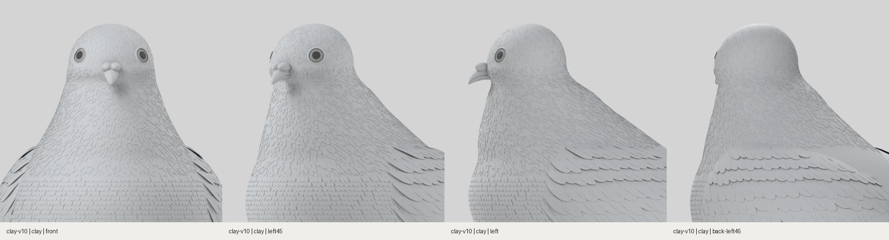
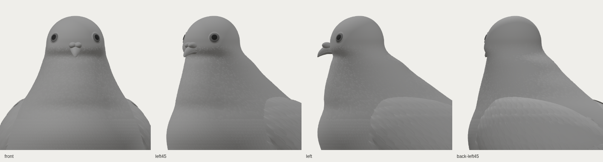

# R01 두상·목 연결과 겹깃 수정 · clay-v10

2026-10-30. 기준 사진과 다른 v9의 옆머리 부풀음·머리 아래 잘록함·긴 아래 얼굴·목깃의 가로줄을 수정했습니다. 색 작업은 보류하고 깃털을 모두 표시한 실제 무채색 3D 렌더를 대표 결과로 사용합니다.

- 눈높이의 과도한 옆 부피와 뒤통수 부피를 줄이고, 머리 아래에서 목으로 넓어지도록 단면을 수정했습니다.
- 낮은 턱 융기를 줄이고 볼의 위치를 높였습니다. 목 앞면에는 완만한 부피를 주어 길고 곧은 연결부를 완화했습니다.
- 목깃 가로줄을 불규칙한 위치의 가는 겹깃 4,000개로 교체했습니다. 위쪽의 작고 밀착된 깃이 아래쪽으로 길어지며, 관찰 방향에 따라 아래·뒤쪽 흐름이 읽히도록 조정했습니다.
- 목깃과 머리 잔결을 겹쳐 연결하고 눈·납막 주변은 실제 위치에 맞춰 비웠습니다. 기존 색·조명은 변경하지 않았습니다.

[전신 5방향](web-clay-five-views.png) · [얼굴 3방향](web-clay-head-three-views.png) · [Blender 촬영 기록](head-neck/capture-record.json) · [웹 검증 기록](web-report.json) · [모델 생성 기록](model-report.json)

[Blender 원본](../../../../art/pigeon/pigeon.blend) · [GLB](../../../../src/assets/pigeon/pigeon.glb) · [매개변수](../../../../art/pigeon/profiles.json) · [해시](../../../../src/assets/pigeon/manifest.json)

이 결과가 R01과 완전히 같다고 판정하지 않습니다. 미세 깃가지, 목깃의 입체 형태와 얼굴 조형은 계속 사진에 대조해야 하며, 광학적 목 광택과 리그·7종 자세는 아직 구현하지 않았습니다. 사진 원본 파일의 픽셀 실측 없이 외형 일치율을 제시하지 않습니다.

## 실행

[작업 브랜치 ZIP](https://github.com/poosuck/All_sorts_of_nonsense/archive/refs/heads/codex/pigeon-clay-v1.zip)을 풀고 `npm ci`, `npm run dev`를 실행합니다. http://localhost:5173/pigeon?frame=head-neck 에서 **clay-v10 / 무채색**을 확인합니다. master 병합이나 배포는 수행하지 않았습니다.

## 검증

프로덕션 빌드, 단위 검사 13건, 푸딩 원본 일치 검사, 비둘기 E2E 4건 통과. 무채색 웹 캡처 15장과 Blender 머리·목 4방향의 해시가 최종 GLB·원본 기록과 일치합니다. [범위 확인](scope-audit.json)에서 .55H 아래 본체 정점 4,880개와 기존 재질 매개변수 보존을 확인했습니다. 기술 검증은 참고 사진과의 외형 일치 판정이 아닙니다.
