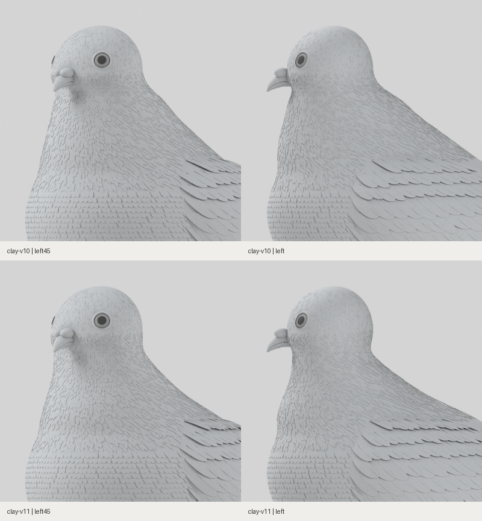
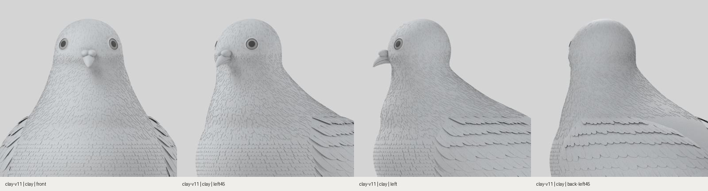

# 측면 뒷목·어깨 연결 수정 · clay-v11

2026-10-30. 머리에서 몸통으로 길게 펼쳐지는 뒷목의 사선 면을 줄였습니다. 같은 카메라·조명·무채색 재질에서 깃털을 모두 표시한 실제 3D 렌더입니다.

- 목의 좌우 폭을 유지하며 뒤쪽 두께를 줄였습니다. 뒤통수 아래의 얕은 굴곡에서 어깨로 곡률이 바뀌도록 조정했습니다.
- 앞목의 일부 부피를 뒤로 정리해 턱 아래에서 가슴까지 이어지는 긴 직선 인상을 완화했습니다.
- 어깨 윗부분의 덮깃 크기를 단계적으로 줄여 목깃과 큰 날개깃 사이를 연결했습니다.
- 정수리·얼굴 매개변수와 부리 위치·색·조명은 유지했습니다. 정면 폭 보존과 변경 범위는 [검사 기록](scope-audit.json)에 있습니다.

[웹 머리·목](web-clay-head-neck-four-views.png) · [전신](web-clay-five-views.png) · [얼굴](web-clay-head-three-views.png) · [Blender 촬영 기록](head-neck/capture-record.json) · [웹 검증](web-report.json)

[Blender 원본](../../../../art/pigeon/pigeon.blend) · [GLB](../../../../src/assets/pigeon/pigeon.glb) · [프로필](../../../../art/pigeon/profiles.json) · [모델 기록](model-report.json)

목표 사진과의 완전 일치 판정은 아닙니다. 깃털의 미세 구조와 얼굴 조형에는 차이가 남으며, 사진 실측 없이 일치율을 제시하지 않습니다.

## 로컬 확인

[작업 브랜치 ZIP](https://github.com/poosuck/All_sorts_of_nonsense/archive/refs/heads/codex/pigeon-clay-v1.zip)을 풀고 `npm ci`, `npm run dev`를 실행합니다. http://localhost:5173/pigeon?frame=head-neck 에서 상단 **clay-v11**을 확인합니다. master 병합·배포는 수행하지 않았습니다.

## 검증

빌드, 단위 검사 13건, 원본 일치 검사, 비둘기 E2E 4건 통과. 실제 무채색 웹 15장과 Blender 4방향 기록이 최종 GLB·원본 해시와 일치합니다. 본체 정점 9,600개의 좌우 좌표와 .55H 아래 정점 4,880개의 위치를 보존했습니다. [전후 촬영 조건 확인](comparison-record.json)에서 같은 카메라·조명·24샘플 사용을 확인합니다.
