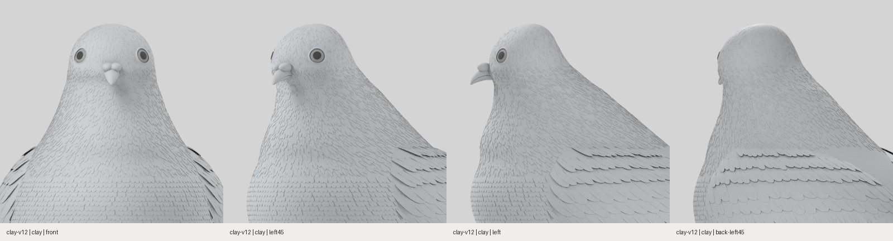
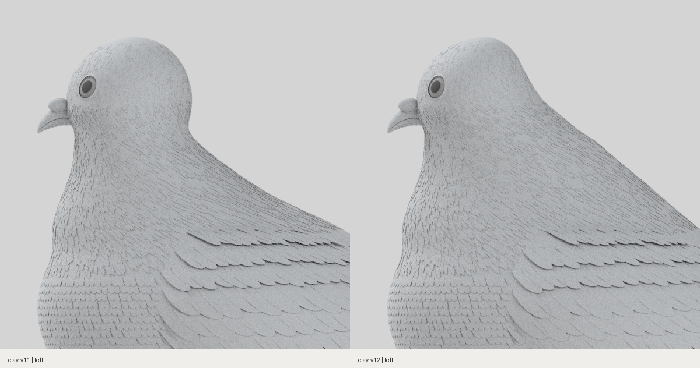

# 후두부 돌출·목 패임 수정 · clay-v12

2026-10-30. v11에서 둥근 후두부 아래를 깎아 만든 패임을 제거했습니다. 목표 사진에서 머리 뒤 윤곽이 목으로 넓어지는 흐름을 기준으로, 뒤쪽 두개골 부피와 목·어깨 위치를 함께 수정했습니다.

- 머리 뒤쪽 두께를 줄이고, 머리 뒤의 수직 벽처럼 보이던 윤곽을 목으로 기울어지게 조정했습니다.
- 후두부 아래에 안으로 들어가는 홈을 두지 않았습니다. 뒤쪽 곡선은 형태 보존 보간으로 연결하고 실제 GLB에서 윤곽 역전 여부를 검사합니다.
- 어깨 윗부피가 시작되는 위치도 함께 올려 목에서 등까지 단순한 긴 사선으로 연결하지 않도록 조정했습니다.
- 정면 폭·앞면 조형·부리 매개변수·기존 색·조명은 유지합니다. 눈과 깃털은 바뀐 표면에 따라 다시 배치됩니다.

[웹 머리·목](web-clay-head-neck-four-views.png) · [전신](web-clay-five-views.png) · [원본 촬영 기록](head-neck/capture-record.json) · [웹 검증](web-report.json) · [변경 범위·회귀 검사](scope-audit.json)

[Blender 원본](https://github.com/poosuck/All_sorts_of_nonsense/blob/f31a423e565b1037283628fa949bbb9dde7bae46/art/pigeon/pigeon.blend) · [GLB](https://github.com/poosuck/All_sorts_of_nonsense/blob/f31a423e565b1037283628fa949bbb9dde7bae46/src/assets/pigeon/pigeon.glb) · [프로필](https://github.com/poosuck/All_sorts_of_nonsense/blob/f31a423e565b1037283628fa949bbb9dde7bae46/art/pigeon/profiles.json) · [모델 해시](model-report.json)

사진과 완전히 일치한 완성 판정은 아닙니다. 얼굴과 미세 깃털 구조의 차이는 남아 있으며 사진 실측 없이 일치율을 제시하지 않습니다.

## 로컬 확인

[작업 브랜치 ZIP](https://github.com/poosuck/All_sorts_of_nonsense/archive/refs/heads/codex/pigeon-clay-v1.zip)을 풀고 `npm ci`, `npm run dev`를 실행합니다. http://localhost:5173/pigeon?frame=head-neck 에서 **clay-v12 / 무채색**을 확인합니다. master 병합·배포는 하지 않았습니다.

## 검증

빌드, 단위 검사 14건, 원본 일치 검사, 비둘기 E2E 4건 통과. 새 회귀 검사는 실제 GLB의 .60H~.95H 뒤 윤곽을 검사하며 이전 v11의 목 패임은 검출하고 현재 모델은 통과합니다. 같은 카메라·조명·24샘플의 전후 촬영 조건을 확인했습니다. 무채색 웹 15장과 Blender 4방향 기록이 최종 자산 해시와 일치합니다.
