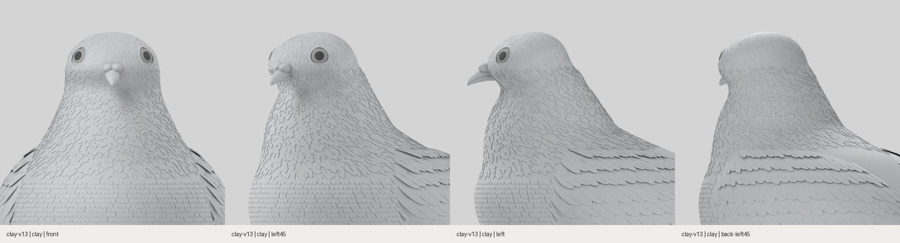
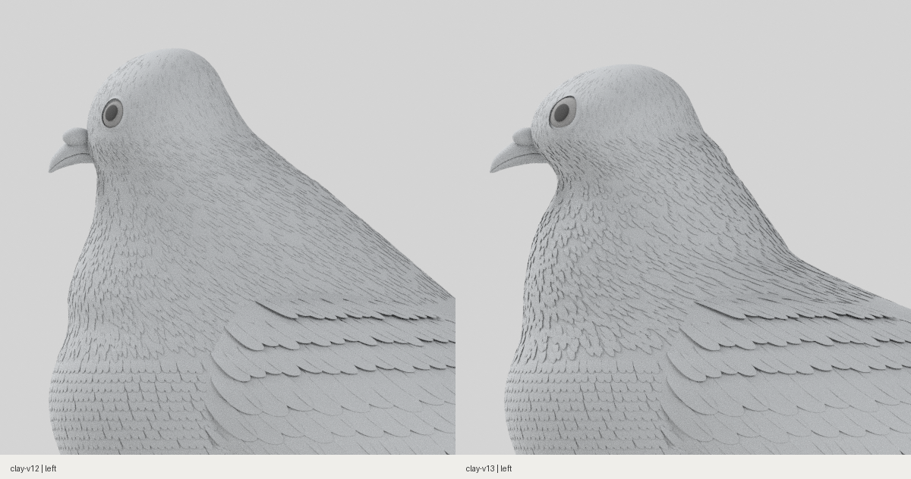

# 두상·앞목·뒷목·목깃 조정 · clay-v13

2026-10-30. 기준 사진과 옆모습을 대조해 높은 두상과 작은 눈, 곧은 앞목, 뒤로 길게 펼쳐진 목, 선 형태의 목깃을 수정했습니다. 아래는 깃털을 모두 표시한 실제 3D 무채색 렌더입니다.

- 정수리를 낮추고 두상의 앞뒤·좌우 폭을 넓혔습니다. 위쪽 머리 정점만 세로로 압축하고 아래 몸통은 유지합니다.
- 눈 크기를 키우고 넓어진 얼굴에 맞춰 부리 노출 길이와 납막 위치를 조정했습니다.
- 턱 아래의 짧은 오목 곡선과 그 아래 가슴의 볼록한 곡선을 나누어 조형했습니다.
- 뒷목의 경사를 더 세우고 어깨 연결을 앞쪽으로 당겼습니다. 후두부 아래에 사람처럼 잘록한 홈을 만들지 않습니다.
- 목깃을 길고 가는 선에서 짧고 넓은 입체 메시 3,100개로 바꿨습니다. 들린 끝·겹침을 만들고 위쪽에서는 작고 아래로 갈수록 길어지도록 구성했습니다.

[웹 머리·목](web-clay-head-neck-four-views.png) · [전신](web-clay-five-views.png) · [얼굴](web-clay-head-three-views.png) · [원본 촬영 기록](head-neck/capture-record.json) · [웹 검증](web-report.json) · [범위 확인](scope-audit.json)

[Blender 원본](../../../../art/pigeon/pigeon.blend) · [GLB](../../../../src/assets/pigeon/pigeon.glb) · [프로필](../../../../art/pigeon/profiles.json) · [모델 해시](model-report.json)

원본 좌표에서 머리 높이가 낮아졌습니다. 웹은 최종 높이를 1로 맞추어 표시하며, 전후 비교 이미지는 같은 Blender 카메라와 원본 좌표를 사용합니다. 사진과 완전히 같은 완성 판정은 아니며 미세 깃가지와 얼굴 세부 조형에는 차이가 남습니다. 색과 조명은 변경하지 않았습니다.

## 로컬 확인

[작업 브랜치 ZIP](https://github.com/poosuck/All_sorts_of_nonsense/archive/refs/heads/codex/pigeon-clay-v1.zip)을 풀고 `npm ci`, `npm run dev`를 실행합니다. http://localhost:5173/pigeon?frame=head-neck 에서 **clay-v13 / 무채색**을 확인합니다. master 병합·배포는 수행하지 않았습니다.

## 검증

빌드, 단위 검사 14건, 원본 일치 검사, 비둘기 E2E 4건 통과. 낮춘 머리 위로 메시나 잔깃이 남지 않는지와 목 뒤에 패임이 생기지 않는지를 실제 자산으로 검사합니다. 웹 무채색 15장과 Blender 4방향 기록의 해시가 최종 GLB·원본과 일치합니다. 같은 카메라·조명·24샘플로 전후를 촬영했습니다.
