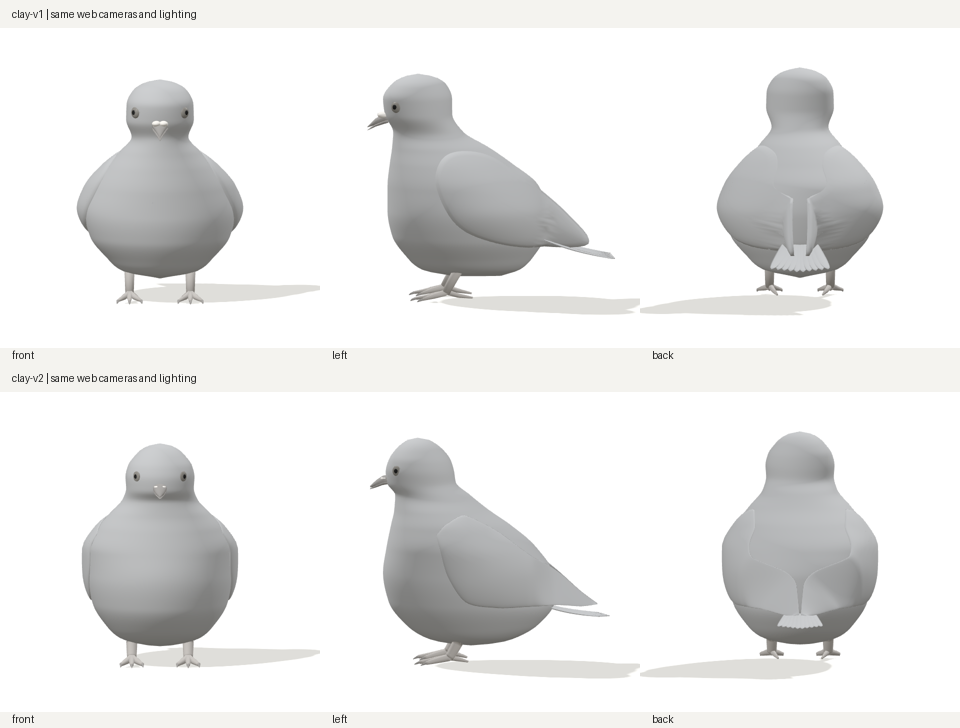
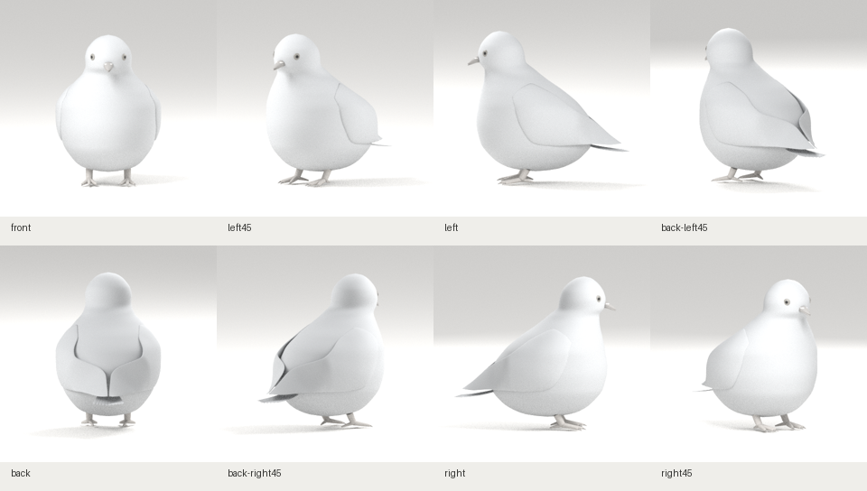

# R01 체형 수정본 · clay-v2

2026-10-29 작성. 이전 체형 자가점검을 반영한 **무채색 체형 수정본**입니다. 목표 시트와 최종 외형이 일치한다는 판정은 아닙니다.

## 전후 비교



위는 기존 clay-v1, 아래는 clay-v2입니다. 같은 웹 카메라·조명·서기 자세를 사용했습니다. 비교 이미지의 각 캡처를 동일한 크기로 축소했으며 개체별 크기나 실루엣을 따로 변형하지 않았습니다.



## 수정과 자가점검

| 부위 | v1에서 확인한 문제 | v2 변경 | 남은 차이 |
|---|---|---|---|
| 가슴·배 | 하복부에 최대 부피가 몰린 배 모양, 긴 밑면 | 최대 폭 위치를 위로 이동하고 가슴·어깨 부피를 보강. 아래 배 단면을 둥글게 축소 | 목표의 부드러운 가슴 깃과 하복부 잔깃 실루엣은 없음 |
| 목 | 목 뿌리가 좁고 어깨와 급하게 이어짐 | 목 뿌리와 위 가슴 단면을 넓혀 연속 곡면으로 연결 | 목 깃이 만드는 두께와 턱 아래 세부 형태 필요 |
| 머리·얼굴 | 평평한 정수리, 돌출된 눈과 납막, 가는 부리 | 정수리·볼 단면 재조정, 눈과 납막을 얇게 밀착, 부리 뿌리 두께 보강 | 눈꺼풀·눈테·볼·납막 경계의 정교한 조형 필요 |
| 날개 | 옆구리에 붙인 타원 판, 후면의 세로 지느러미 형태 | 앞뒤 단면을 따라 접힌 날개 외피를 재구성. 뒤쪽 단면을 안쪽으로 기울여 긴깃 방향으로 수렴 | 어깨 접합선이 여전히 읽힘. 덮깃으로 뿌리를 덮고 긴깃 층을 만들어야 함 |
| 후면·꼬리 | 날개 사이에서 솟는 끝, 아래에 따로 붙은 부채꼴 꼬리 | 엉덩이 부피·날개 끝 연결 조정, 꼬리 폭과 각도 축소 | 중앙 날개 끝·꼬리 경계는 아직 단순한 외피. 목표의 깃별 겹침과 날깃 길이 조정 필요 |
| 다리·발 | 길고 가는 발가락과 노출된 다리 | 발 위치·길이·두께 조정, 관절을 부드러운 곡선으로 연결 | 발가락 마디·발톱·피부 세부는 없음 |

부피를 늘려 날개 끝을 덮는 중간안은 후면이 과해지고 꼬리가 짧아 보여 폐기했습니다. 현재 저장된 모델은 후면 몸통 부피를 줄이고 날개 단면의 방향을 수정한 결과입니다. 중간안은 배포하지 않습니다.

## 원본과 배포 자산

- [Blender 원본](../../../../art/pigeon/pigeon.blend)과 [GLB](../../../../src/assets/pigeon/pigeon.glb)는 같은 자체 제작 소스에서 생성했습니다.
- Blender 4.3.2, GLB 632,844 bytes, 삼각형 34,052개, 메시 37개.
- GLB SHA-256: `65150991e1117c8187267e147c5f939a5f838d5cb5247c6a721a9a55816387b8`
- Blender SHA-256: `ef51f8782583b6bd04ec71f13a9924246c41825650fc22869fa5eecb011bf96b`
- 모델 실제 폭/H 0.693, 길이/H 1.063. **참고 이미지의 실측값이 아닙니다.**
- [모델 생성 기록](model-report.json) · [원본·프로필·배포 해시](../../../../src/assets/pigeon/manifest.json)
- [이전 clay-v1 기록](../clay-v1/README.md)은 별도로 보존했습니다.

## 검증 결과

이번 검증은 로컬 Blender 4.3.2와 시스템 Chromium으로 수행했습니다. 과거 v1의 CI 실행 기록을 이번 모델의 검증으로 재사용하지 않았습니다.

| 검사 | 결과 |
|---|---|
| Blender 생성·8방향 렌더 | 통과 |
| 프로덕션 빌드 | 통과 |
| 단위 검사·원본/프로필/GLB 해시 일치 | 통과 |
| 기존 푸딩 원본 일치 검사 | 통과 |
| Chromium 프로덕션 E2E | 4건 통과: 8방향 전환, 손상 데이터 재시도, 로딩 중 이탈, 좁은 화면 |
| 실제 웹 8방향 캡처 | 같은 GLB 요청 1회, 페이지 예외 0건 |

[웹 검증 기록](web-report.json)에 사용한 GLB 해시와 각 캡처 경로가 있습니다. 기술 검사 통과는 목표 외형 완성 판정과 별개입니다.

## 실제 웹의 8방향

| 정면 | 좌측 45° | 좌측면 | 후면 좌측 45° |
|---|---|---|---|
| [캡처](web-front.png) | [캡처](web-left45.png) | [캡처](web-left.png) | [캡처](web-back-left45.png) |

| 후면 | 후면 우측 45° | 우측면 | 우측 45° |
|---|---|---|---|
| [캡처](web-back.png) | [캡처](web-back-right45.png) | [캡처](web-right.png) | [캡처](web-right45.png) |

## 다음 제작 구간

1. 어깨 덮깃으로 날개 뿌리를 연결하고 작은·중간·큰 덮깃 층을 구축합니다.
2. 뒤쪽 날깃과 꼬리깃의 길이·겹침을 구분하고 후면 수렴 형태를 조정합니다.
3. 목·머리·가슴 잔깃과 얼굴 확대 디테일을 제작합니다.
4. 형상 확인 후 회색 깃색·두 줄 날개 무늬·주황 홍채·목 광택을 적용합니다.

현재는 서기 1종입니다. 리그·7종 자세는 미구현이며, R01 원본 이미지 파일 보관·픽셀 실측도 남아 있습니다. 카메라·조명으로 체형 차이를 가리는 보정은 적용하지 않았습니다.

## 로컬 확인

```sh
git fetch origin
git switch codex/pigeon-clay-v1
git pull --ff-only origin codex/pigeon-clay-v1
npm ci
npm run dev
```

http://localhost:5173/pigeon 에서 확인합니다. 브랜치 이름은 기존 작업 브랜치 그대로이며 포함 모델의 리비전은 **clay-v2**입니다. 일반 웹 확인에는 Blender가 필요 없습니다.
