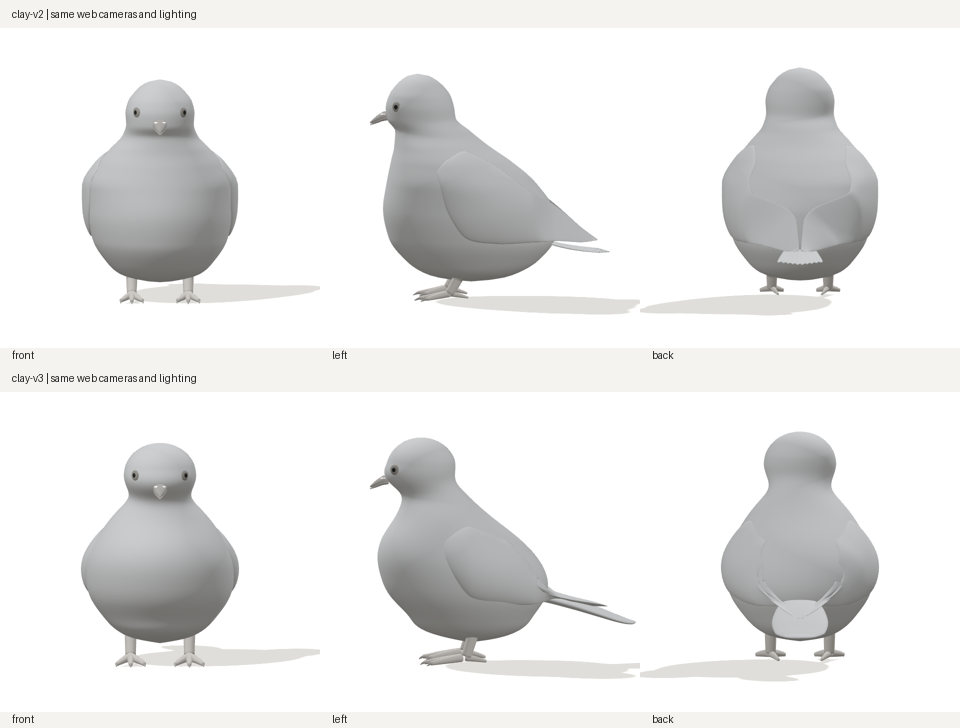
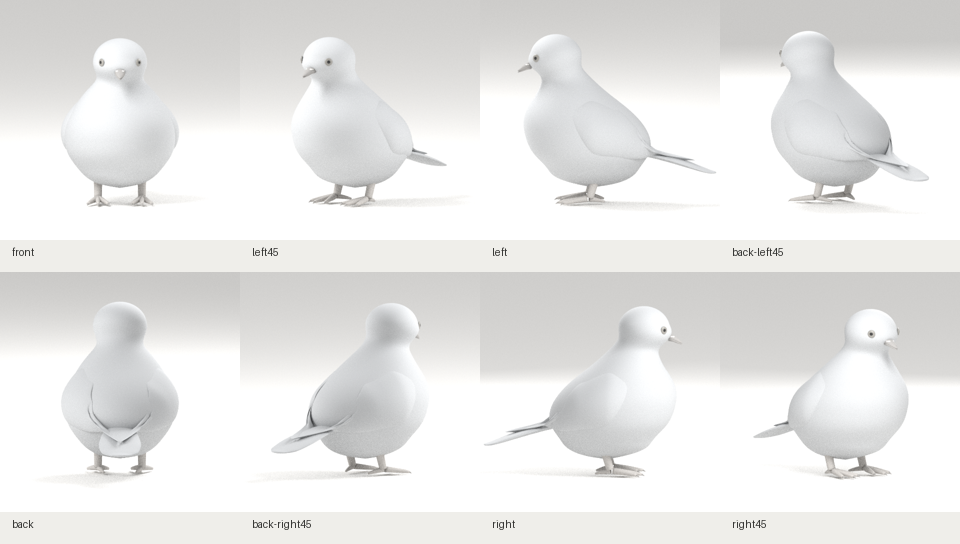

# R01 체형 우선 수정 · clay-v3

2026-10-29 작성. 목표는 R01 시트 속 비둘기를 하나의 3D 모델로 구현하는 것입니다. 이번 수정은 **기본 체형**에 집중했습니다. 체형 검토가 끝나기 전에는 깃털·색·광택·자세 제작으로 넘어가지 않습니다.

## 전후 비교



같은 웹 카메라·조명·서기 자세를 사용했습니다. 각 캡처는 동일한 크기로 축소했으며, 시점마다 개체의 실루엣이나 크기를 따로 변형하지 않았습니다.



## 체형 수정

| 부위 | v2 문제 | v3 변경 |
|---|---|---|
| 몸통 정면 | 중간 높이의 폭이 일정해 통처럼 보임 | 가슴 중간에 최대 부피를 모으고 어깨·하복부로 좁아지는 단면으로 조정 |
| 몸통 측면 | 목에서 가슴까지 앞선이 수직에 가까움 | 턱 아래의 약한 오목한 연결, 앞으로 나온 가슴, 안으로 말리는 배의 곡선 구성 |
| 머리·목 | 둥근 기둥 같은 머리, 머리와 가슴의 구분 부족 | 볼 아래·목·뒷목 단면 조정, 둥근 정수리 면과 촘촘한 상단 메시 구성 |
| 날개 | 외곽 전체의 붙인 판 느낌, 잘못 기울어진 뒤쪽 단면 | 앞 뿌리를 몸통에 더 묻고, 뒤쪽은 위·바깥 어깨에서 아래·안쪽 끝으로 모이도록 수정. 높은 경계는 몸통 쪽으로 당겨 연결 |
| 꼬리 | 측면의 가는 막대, 후면의 작은 부채 | 엉덩이 축을 따르는 넓고 납작한 기본 부피로 재구성. 끝은 둥글게 좁아짐 |
| 다리·발 | 몸통과의 부착 위치·발가락 부피 부족 | 다리 위치를 몸 아래로 조정하고 앞·뒤 발가락을 넓고 도톰하게 구성 |

몸통의 단면 보간을 바꿔 높이에 따라 곡률이 급하게 바뀌는 현상도 줄였습니다. 정수리는 단순한 단면 보간 대신 타원체 면으로 마감했습니다. 웹 상단에 현재 모델 리비전을 표시해 이전 버전과 구분할 수 있습니다.

## 자가점검과 남은 차이

- v2보다 정면의 통 모양이 줄고 측면의 가슴·배 굴곡이 더 분명해졌습니다. 정수리의 평평한 면도 보정했습니다.
- 첫 중간안의 하복부 무게감·평평한 정수리·네모난 꼬리 끝을 실제 캡처에서 확인하고 수정했습니다. 이 중간안은 별도로 배포하지 않습니다.
- 날개 뒤쪽 단면의 기울기만 바꾼 중간안은 위쪽 경계가 엉덩이를 두르는 들린 판처럼 보여 수정했습니다. 현재안은 높은 경계를 본체에 당겨 묻어 깊은 틈과 45° 시점의 들린 경계를 줄였습니다.
- **목표 체형의 최종 통과 판정은 아직 아닙니다.** 후면 날개 끝의 V자와 경계가 지나치게 또렷하고, 꼬리가 낮은 별도 덩어리로 읽히며 다리 노출도 조금 길게 보입니다. 이 세 부분과 얼굴의 볼·턱·눈 주변 형상을 계속 대조해야 합니다.
- 날개와 꼬리는 기본 부피입니다. 겹깃과 꼬리깃을 만들었다고 표시하지 않습니다. 참고 시트의 체형은 대화 이미지를 보고 추정했으며 픽셀 실측값이 아닙니다.

다음 수정도 몸통·머리·목과 날개·꼬리 **기본 형상** 검토를 이어갑니다. 깃털로 접합부를 덮어 체형 문제를 보류하지 않습니다.

## 산출물과 재현

- [Blender 원본](../../../../art/pigeon/pigeon.blend)
- [배포 GLB](../../../../src/assets/pigeon/pigeon.glb)
- [단면 매개변수](../../../../art/pigeon/profiles.json) · [제작 코드](../../../../scripts/pigeon-stage1/build.py)
- [원본·GLB·프로필 해시와 버전](../../../../src/assets/pigeon/manifest.json) · [모델 생성 기록](model-report.json)
- [이전 clay-v2 기록](../clay-v2/README.md)

Blender 4.3.2에서 자체 제작 소스로 원본과 GLB를 함께 생성했습니다. 이전 삭제 모델이나 외부 생성 코드를 불러오지 않습니다. 개별 꼬리깃 대신 꼬리 기본 부피 하나를 사용하므로 메시 개수는 이전 버전과 다릅니다.

GLB 822,452 bytes, 삼각형 44,168개, 메시 28개입니다. 실제 모델의 폭/H는 0.702, 길이/H는 1.180이며 참고 시트의 실측값은 아닙니다.

## 검증 결과

최종 GLB 해시 `e3af61181c76412fe3df03dd6e2f58b7e4a07aeac5cad537477cd5205dabdc81`로 다시 빌드·실행했습니다. 중간안의 캡처나 검사 결과를 최종안으로 재사용하지 않았습니다.

| 검사 | 결과 |
|---|---|
| Blender 생성·8방향 렌더 | 통과 |
| 프로덕션 빌드 | 통과 |
| 단위 검사·원본/프로필/GLB 해시 일치 | 통과 |
| 기존 푸딩 원본 일치 검사 | 통과 |
| Chromium 프로덕션 E2E | 4건 통과: 8방향 전환, 손상 데이터 재시도, 로딩 중 이탈, 좁은 화면 |
| 실제 웹 캡처 | 8방향, 같은 GLB 요청 1회, 페이지 예외 0건 |

[웹 검증 기록](web-report.json)에 모델 해시와 캡처 경로를 보관했습니다. 검증은 로컬 Blender·Chromium에서 수행했으며 기술 검사 통과를 체형 완성 판정으로 사용하지 않습니다.

## 실제 웹 8방향

| 정면 | 좌측 45° | 좌측면 | 후면 좌측 45° |
|---|---|---|---|
| [캡처](web-front.png) | [캡처](web-left45.png) | [캡처](web-left.png) | [캡처](web-back-left45.png) |

| 후면 | 후면 우측 45° | 우측면 | 우측 45° |
|---|---|---|---|
| [캡처](web-back.png) | [캡처](web-back-right45.png) | [캡처](web-right.png) | [캡처](web-right45.png) |

## 로컬 확인

```sh
git fetch origin
git switch codex/pigeon-clay-v1
git pull --ff-only origin codex/pigeon-clay-v1
npm ci
npm run dev
```

http://localhost:5173/pigeon 에서 상단에 **clay-v3**가 표시되는지 확인합니다. 작업 브랜치 이름은 기존 `codex/pigeon-clay-v1`을 유지합니다. 일반 웹 확인에는 Blender가 필요 없습니다.
