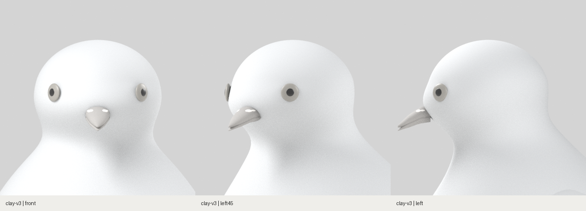

# 두상 대조 · clay-v3

이 기록은 수정 전 v3입니다. 비교를 반영한 [clay-v4 두상 수정과 전후 캡처](../../clay-v4/README.md)를 별도로 보관했습니다.

기준: 대화에 첨부된 R01 시트의 상단 8방향과 우상단 얼굴 확대. 아래 이미지는 현재 제작물의 정면·45°·측면 확대입니다. 참고 시트는 정투영 실측 도면으로 취급하지 않았습니다.

**현재 핵심 문제는 큰 구형 두개부의 앞끝에 눈과 부리가 몰리고, 볼·턱의 국소 부피가 부족하다는 점입니다.**

| 부위 | 목표 시트 | 현재 제작물 | 수정 방향 |
|---|---|---|---|
| 정수리·이마 | 둥근 정수리와 부리 뿌리로 이어지는 이마가 구분됨 | 눈 위부터 뒤통수까지 거의 같은 곡률의 큰 반구 | 이마 높이·기울기와 정수리·뒤통수 곡률을 따로 조정 |
| 눈의 위치 | 눈이 얼굴 옆면에 자리 잡아 앞얼굴·뒤통수의 균형을 이룸 | 측면에서 눈이 앞 경계에 가깝고 눈 뒤가 크게 비어 보임 | 눈·안와를 옆면 쪽으로 옮기고 뒤통수의 후방 부피도 함께 조정 |
| 눈 주변 | 눈테·눈꺼풀과 주변 얼굴 부피가 눈을 감쌈 | 얇은 원판이 매끈한 표면에 붙은 형태 | 안와에 안구를 넣고 위·아래 눈꺼풀과 눈테를 연결 |
| 볼·턱 | 눈 아래 볼과 부리 양옆의 짧은 얼굴, 턱 아래 부피가 읽힘 | 눈 아래부터 목까지 별도 볼·턱 형태가 거의 없음 | 볼·하악 부피를 만들고 부리 뿌리와 턱을 연결 |
| 뒤통수·목 | 뒤통수가 뒷목으로 경사지게 이어짐 | 뒤통수의 빈 면적이 크고 앞목은 부리 아래에서 급하게 파임 | 후방 돌출을 정리하고 턱 아래 오목함을 완화 |
| 부리·납막 | 두꺼운 부리 뿌리, 볼록한 윗부리와 굽은 끝, 콧등에 붙은 두 갈래 납막 | 얇고 직선적인 삼각 쐐기와 작은 납막 두 점 | 부리 뿌리·윗부리 곡률과 납막 부피를 함께 재구성 |

눈의 인상에는 현재 없는 홍채색·눈테도 영향을 주므로, 목표 대비 눈 확대율을 수치로 확정하지 않습니다. 우선순위는 **눈 위치·두개부 전후 균형 → 이마·볼·턱·뒤통수 → 부리·납막 → 눈꺼풀·눈테**입니다. 높이별 타원 단면 외에 눈 주변과 볼·턱을 국소적으로 조형해야 합니다.

## 캡처 근거

- 모델 소스 커밋: `6ecb56aca770ed68574e4e61aefa7fb7398a548a`
- 현재 Blender 원본을 열어 카메라만 변경했습니다. 형상·재질·조명과 원본 파일은 그대로 유지했습니다.
- 정면 0°, 좌측 45°, 좌측면 90°, 수평 시선, 정투영 범위 0.49, 각 600×600입니다.
- [캡처 위치·모델 해시](capture-record.json) · [정면 원본](head-front.png) · [45° 원본](head-left45.png) · [측면 원본](head-left.png)
- 재현: 프로젝트 루트에서 `blender -b --factory-startup -t 2 --python-exit-code 1 --python scripts/pigeon-stage1/review_head.py`

이번 기록은 두상 비교입니다. 두상 수정 결과로 표시하지 않습니다.
