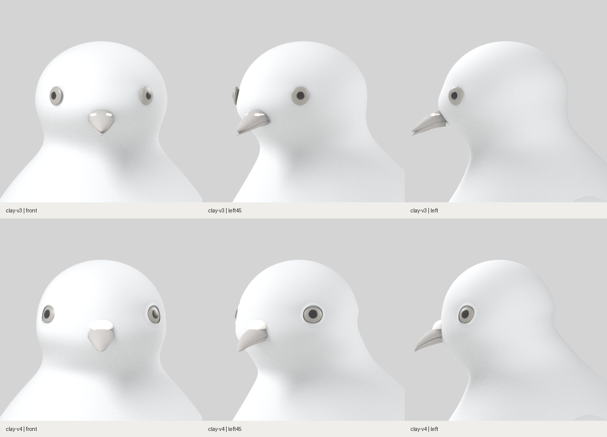
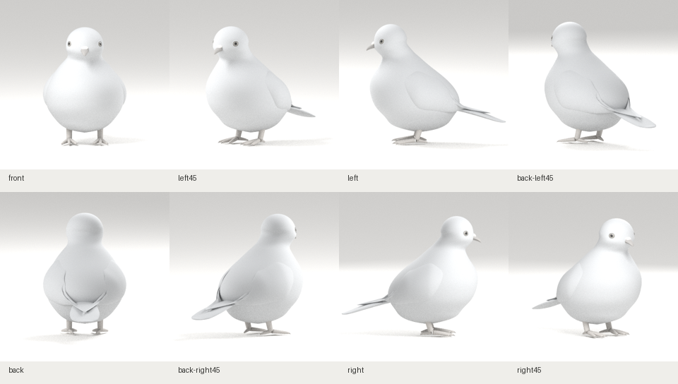

# R01 두상 수정 · clay-v4

2026-10-29 작성. [clay-v3 두상 대조](../clay-v3/head/README.md)를 바탕으로 눈·안와, 이마·뒤통수, 볼·턱, 부리·납막을 수정했습니다. 목표는 R01의 입체 외형이며 현재도 체형 검토 단계입니다.

과거 v4 기록입니다. 이후 정면 대조에서 머리 폭·눈 간격·목 연결이 목표와 크게 다름을 확인했습니다. 이 핵심 비율을 재작업한 [clay-v5](../clay-v5/README.md)를 별도로 보관합니다. 아래 검사 통과는 해당 비율의 적합성을 검증한 결과가 아닙니다.

## 실제 두상 전후 비교



같은 모델 제작 경로에서 생성한 원본을 동일한 조명·재질·수평 정투영 카메라로 촬영했습니다. 시점별 카메라 위치·타깃·정투영 범위가 이전 기록과 일치하는지 확인했습니다. R01은 대화 이미지의 시각 비교 기준이며 픽셀 실측 도면으로 취급하지 않았습니다.

| 항목 | v3 문제 | v4 수정 |
|---|---|---|
| 눈 위치 | 두개부 앞끝에 몰리고 눈 뒤 면적이 큼 | 눈을 뒤·옆으로 이동하고 새 표면의 법선에 맞춰 배치 |
| 안와·눈꺼풀 | 표면에 얇은 원판이 붙은 형태 | 국소 안와를 조형하고 안구를 묻음. 표면에 붙는 얇은 눈꺼풀 띠로 연결 |
| 이마·뒤통수 | 거의 같은 곡률의 큰 반구 | 별도 두상 단면과 정수리 계수로 이마·뒤통수 부피 재배분 |
| 볼·턱·목 | 볼과 하악 부피가 약하고 턱 아래가 급하게 파임 | 눈 아래 볼·턱을 국소 변형하고 앞목 연결을 채움 |
| 부리 | 얇은 직선 쐐기와 벌어진 두 판 인상 | 둥근 뿌리와 아래로 굽는 윗부리, 좁은 틈으로 맞물리는 아랫부리 구성 |
| 납막 | 작은 두 점 | 부리 뿌리에 이어지는 하나의 낮은 융기로 구성. 첫 중간안의 각진 나비넥타이 윤곽은 폭·중앙 골·단면을 보정해 제거 |

### 남은 차이

1. 이마·정수리는 목표보다 매끈한 큰 돔으로 읽히는 부분이 남아 있습니다.
2. 측면의 눈 전후 위치는 개선됐지만 R01과 계속 대조할 항목입니다. 눈 크기는 무채색 인상만으로 추가 확대하지 않았습니다.
3. 납막은 각진 중간안보다 자연스럽지만 목표의 두 부드러운 융기보다 단순한 둥근 캡입니다.
4. 눈꺼풀·볼·턱의 세밀한 표면 연결과 전체 체형 검토를 이어갑니다. 깃털·색·목 광택·자세 제작은 보류합니다.

**이번 결과는 두상 개선 수정본이며 목표 외형의 최종 통과 판정은 아닙니다.**

## 확대 원본

- [정면](head/head-front.png) · [좌측 45°](head/head-left45.png) · [측면](head/head-left.png)
- [현재 3방향 모음](head/head-three-views.png) · [촬영 위치와 원본 해시](head/capture-record.json) · [전후 카메라 일치 기록](head/comparison-record.json)

## 변경 범위와 산출물

- [당시 Blender 원본](https://github.com/poosuck/All_sorts_of_nonsense/blob/8da66f41c37ae1bf8b50b9273034608d9017a613/art/pigeon/pigeon.blend) · [GLB](https://github.com/poosuck/All_sorts_of_nonsense/blob/8da66f41c37ae1bf8b50b9273034608d9017a613/src/assets/pigeon/pigeon.glb) · [두상 매개변수](https://github.com/poosuck/All_sorts_of_nonsense/blob/8da66f41c37ae1bf8b50b9273034608d9017a613/art/pigeon/profiles.json)
- [모델 생성 기록](model-report.json) · [당시 원본·프로필·배포 해시](https://github.com/poosuck/All_sorts_of_nonsense/blob/8da66f41c37ae1bf8b50b9273034608d9017a613/src/assets/pigeon/manifest.json)
- GLB 924,272 bytes, 삼각형 51,172개, 메시 29개. Blender 4.3.2에서 생성했습니다.
- [변경 범위 대조](head-scope-audit.json): v3 원본 커밋 `6ecb56aca770ed68574e4e61aefa7fb7398a548a`와 비교해 H≤0.70의 몸통 정점 5,840개, 날개·꼬리·다리·발 메시 19개의 위치가 동일합니다. 이 기록은 정점 위치 비교이며 모든 메시 속성의 바이트 일치를 뜻하지 않습니다.

## 전체 8방향



| 정면 | 좌측 45° | 좌측면 | 후면 좌측 45° |
|---|---|---|---|
| [웹 캡처](web-front.png) | [웹 캡처](web-left45.png) | [웹 캡처](web-left.png) | [웹 캡처](web-back-left45.png) |

| 후면 | 후면 우측 45° | 우측면 | 우측 45° |
|---|---|---|---|
| [웹 캡처](web-back.png) | [웹 캡처](web-back-right45.png) | [웹 캡처](web-right.png) | [웹 캡처](web-right45.png) |

## 검증

최종 GLB 해시 `3f35adabd9457b010c183551151abedff2fe91427fff4b9efa5132c8f8faa4c2`를 기준으로 확인했습니다.

| 검사 | 결과 |
|---|---|
| Blender 생성·8방향 렌더·두상 확대 3방향 | 통과 |
| 프로덕션 빌드 | 통과 |
| 단위 검사 | 13건 통과. 원본·프로필·GLB 해시 검사 포함 |
| 기존 푸딩 원본 일치 검사 | 통과 |
| Chromium 프로덕션 E2E | 4건 통과: 8방향 전환, 손상 모델 재시도, 로딩 중 이탈, 좁은 화면 |
| 실제 웹 캡처 | 8방향, 동일 GLB 요청 1회, 페이지 예외 0건 |

[웹 검증 기록](web-report.json). 로컬 실행 결과이며 기술 검사 통과를 외형 일치 판정으로 사용하지 않습니다.

## 로컬 확인

```sh
git fetch origin
git switch codex/pigeon-clay-v1
git pull --ff-only origin codex/pigeon-clay-v1
npm ci
npm run dev
```

http://localhost:5173/pigeon 에서 상단 **clay-v4**를 확인합니다. 작업 브랜치는 기존 `codex/pigeon-clay-v1`입니다. 두상 확대를 다시 생성하려면 [촬영 스크립트](../../../../scripts/pigeon-stage1/review_head.py)를 Blender에서 실행합니다.
