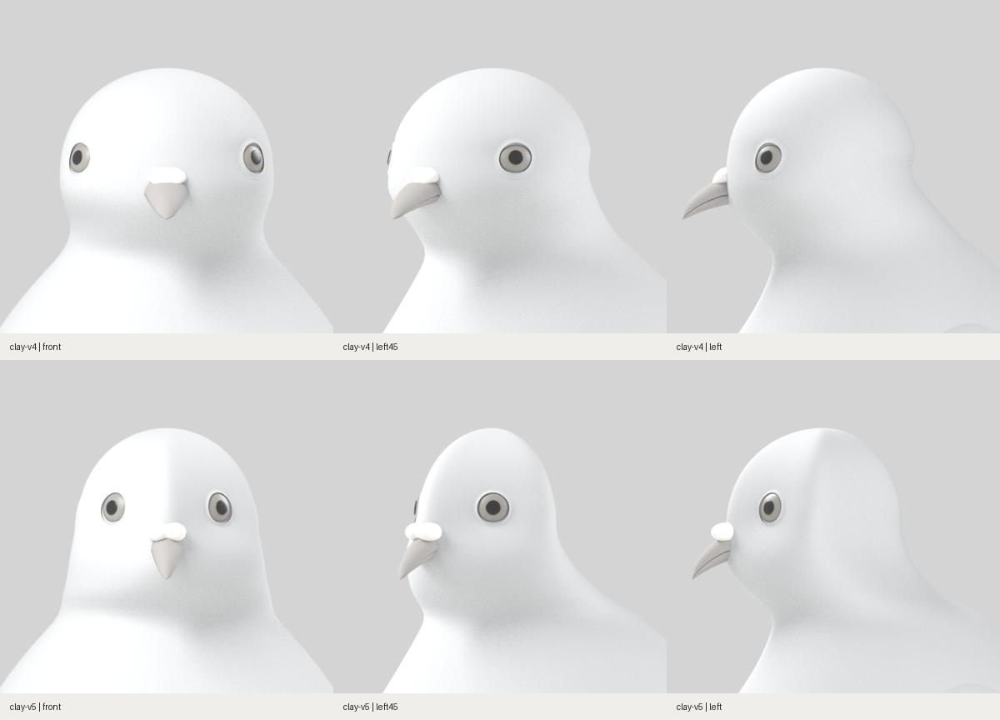
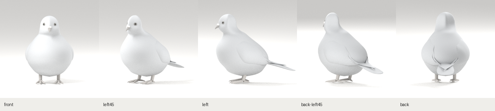

# R01 정면 비율 재작업 · clay-v5

2026-10-29. v4는 머리가 넓은 구형이고 눈 간격이 크며 목이 잘록했습니다. 참고 사진의 좁은 이마, 가까운 눈, 아래로 넓어지는 볼·목과 다른 핵심 비율을 놓쳤습니다. 이 기록은 그 비율을 재작업한 결과이며 목표 재현 완료 판정은 아닙니다.

과거 v5 기록입니다. 전신의 몸통·날개·꼬리 구조를 재작업한 [clay-v6](../clay-v6/README.md)를 별도로 보관합니다.

## 두상 전후



| 항목 | 변경 |
|---|---|
| 두상 외곽 | 머리 폭을 줄이고, 아래쪽 볼·목이 더 넓어지는 형태로 재구성 |
| 눈 간격 | 눈을 정면 중심선 쪽으로 모으고 높이를 조정. 실제 GLB의 양안 중심 간격은 v4의 0.2452H에서 v5의 0.1463H로 감소 |
| 얼굴 면 | 구형 단면에서 이마·눈·볼의 면이 구분되는 완만한 단면으로 변경 |
| 머리·목 | 머리 아래가 잘록하게 꺾이는 연결을 줄이고 목으로 넓어지게 조정 |
| 부리 | 좌우 폭을 줄여 정면에서 가늘고 길게 읽히게 하고, 측면 돌출 길이는 줄임 |
| 납막 | 두 둥근 융기와 연결부를 하나의 매끈한 메시로 합쳐 구성 |

위 수치는 **제작 모델의 좌표**이며 참고 사진의 실측값이 아닙니다. [실제 눈 위치 대조](head/eye-position-comparison.json)와 [동일 카메라 확인](head/comparison-record.json)을 보관했습니다.

## 기준 5방향 대조용 현재 모델



정면의 폭·눈 간격·목 연결을 먼저 검토하고, 나머지 시점에서 두개부 깊이·부리 돌출·뒷목의 연속성을 함께 확인했습니다. 머리만 따로 크기를 바꾼 합성 이미지를 사용하지 않았습니다.

현재도 이마와 볼의 세부 곡률·눈꺼풀·납막 연결을 참고와 대조해야 합니다. 후면 날개·꼬리 연결과 다리 노출량은 앞선 체형의 남은 과제입니다. 깃털·색·광택으로 체형 차이를 가리는 작업은 하지 않습니다.

## 원본과 검증

- [당시 Blender 원본](https://github.com/poosuck/All_sorts_of_nonsense/blob/0de64c9f92da06c2fb711761c909b8052bf7184a/art/pigeon/pigeon.blend) · [GLB](https://github.com/poosuck/All_sorts_of_nonsense/blob/0de64c9f92da06c2fb711761c909b8052bf7184a/src/assets/pigeon/pigeon.glb) · [두상 설정](https://github.com/poosuck/All_sorts_of_nonsense/blob/0de64c9f92da06c2fb711761c909b8052bf7184a/art/pigeon/profiles.json)
- [모델 기록·해시](model-report.json) · [두상 확대 촬영 기록](head/capture-record.json)
- [변경 범위 대조](head-scope-audit.json): v4 대비 H≤0.70의 몸통 정점 5,840개, 날개·꼬리·다리·발 메시 19개의 위치가 동일합니다.
- Blender 4.3.2, GLB 985,664 bytes, 삼각형 54,580개, 메시 29개.
- [Blender 전체 8방향](blender-eight-views.png) · [확대 정면](head/head-front.png) · [확대45°](head/head-left45.png) · [확대 측면](head/head-left.png)
- [웹 8방향 기록](web-report.json): 동일 GLB 요청 1회, 페이지 예외 0건.
- 프로덕션 빌드·단위 검사 13건·기존 푸딩 원본 일치 검사·비둘기 E2E 4건 통과. 이는 기술 검증이며 목표 외형의 합격 판정이 아닙니다.

최종 GLB SHA-256: `6b99dba5e162d1567c2f26aabb65355d0ec9d52f763c3bdda1da39012ba0fb44`.

제작 중 빠른 두상 검토에는 `PIGEON_MODEL_ONLY=1`로 모델만 생성하는 경로를 사용했습니다. 여기 보관한 최종본은 해당 옵션 없이 전체 8방향을 다시 생성하고 웹에서 검증한 결과입니다.

## 로컬 확인

```sh
git fetch origin
git switch codex/pigeon-clay-v1
git pull --ff-only origin codex/pigeon-clay-v1
npm run dev
```

http://localhost:5173/pigeon 상단의 **clay-v5**를 확인합니다.
