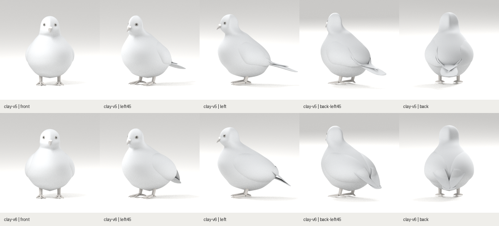
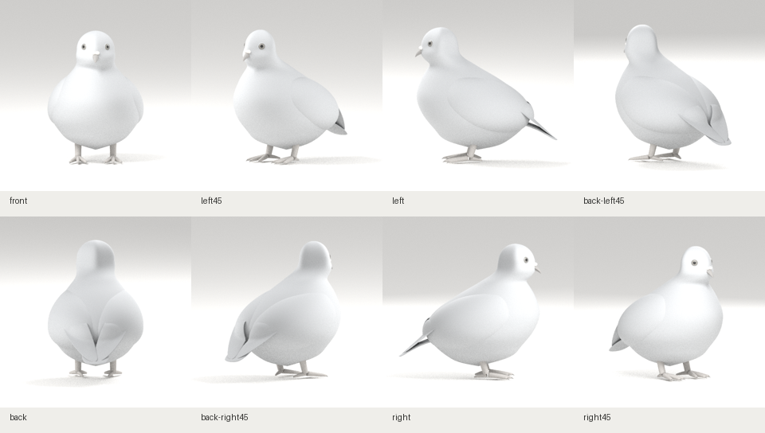

# R01 전신 구조 재구성 · clay-v6

2026-10-29. v5 전신 대조에서 드러난 둥근 몸통, 작은 판형 날개, 길게 노출된 꼬리와 후면의 V자 끝부분을 재작업했습니다. 기준은 사용자가 제공한 R01의 정면·45°·측면·후면45°·후면입니다.

## 같은 카메라의 전후



모델 높이와 카메라·조명 설정을 유지했습니다. 각 칸을 같은 크기로 축소했으며 시점마다 실루엣을 따로 변형하지 않았습니다. [비교 조건 기록](comparison-record.json)

| 부위 | 재구성 |
|---|---|
| 몸통 | 뒤쪽 부피를 늘리고 가슴에서 엉덩이로 이어지는 앞뒤 축을 조정 |
| 어깨·접힌 날개 | 기존 종단 단면 판을 대체. 실제 몸통의 옆면과 등 표면을 감싸는 넓은 부피를 구성하고 경계를 몸통 안으로 묻음 |
| 뒤쪽 날개 | 등 아래부터 꼬리 방향으로 길게 이어지는 외피를 추가. 윗부분은 몸통에 붙이고 뒤쪽은 접힌 날개 축을 따라 연장 |
| 꼬리 | 전체 길이·폭을 줄이고 뿌리를 올려 접힌 날개 아래에 대부분 가려지도록 배치 |
| 머리·목 | 전신 비율에서 두상을 조금 둥글게 조정하고 목 뿌리를 새 몸통 단면에 연결 |

첫 중간안의 V자 판, 다음 중간안의 휘어진 끝과 뜬 부분을 미리보기에서 확인하고 수정했습니다. 여기에 보관한 최종 캡처는 그 뒤 전체 8방향을 다시 생성한 결과입니다.

## 제작 모델의 실제 치수 대조

| 항목 | v5 | v6 |
|---|---:|---:|
| 몸통 앞뒤 길이 | 0.755H | 0.843H |
| 몸통 뒤쪽 끝 위치 | 0.381H | 0.465H |
| 꼬리 뒤쪽 끝 위치 | 0.770H | 0.670H |
| 접힌 날개 끝 밖으로 나온 꼬리 길이 | 0.126H | 0.021H |

[실제 GLB 메시 위치 측정](geometry-comparison.json). H는 모델 높이 기준이며 위 수치는 참고 이미지의 실측값이 아닙니다.

## 현재 8방향



현재는 무채색 기본 부피입니다. 목표의 덮깃·긴깃 겹침과 깃 끝의 외곽은 아직 없으며, 현재 외피 경계가 매끈하거나 또렷하게 보이는 차이가 남습니다. 얼굴·다리·발과 전신 비율도 같은 R01 기준으로 검토를 이어갑니다. 기술 검사 통과를 목표 외형의 합격으로 사용하지 않습니다.

## 원본과 검증

- [Blender 원본](../../../../art/pigeon/pigeon.blend) · [GLB](../../../../src/assets/pigeon/pigeon.glb) · [제작 매개변수](../../../../art/pigeon/profiles.json)
- [모델 생성·해시 기록](model-report.json) · [원본/프로필/GLB 버전](../../../../src/assets/pigeon/manifest.json)
- Blender 원본과 GLB를 같은 자체 소스에서 생성했습니다. 원본 몸통과 날개 형상을 웹에서 별도 메시로 대체하지 않습니다.
- [웹 검증·실제 8방향 캡처 경로](web-report.json)
- 프로덕션 빌드·단위 검사 13건·기존 푸딩 원본 일치 검사·비둘기 E2E 4건 통과. 웹 캡처는 동일 GLB 요청 1회, 페이지 예외 0건입니다.

## 로컬 확인

```sh
git fetch origin
git switch codex/pigeon-clay-v1
git pull --ff-only origin codex/pigeon-clay-v1
npm run dev
```

http://localhost:5173/pigeon 상단의 **clay-v6**를 확인합니다. 이전 [v5 기록](../clay-v5/README.md)은 비교용으로 보존합니다.
