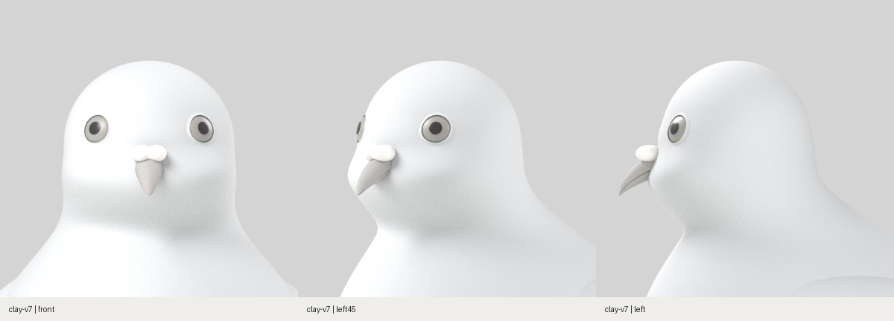
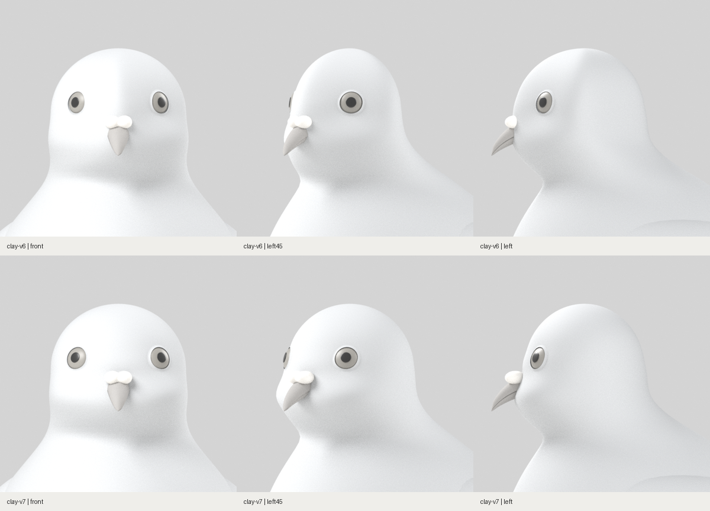

# 둥근 두상으로 재구성 · clay-v7

2026-10-29. 얼굴 전체에 평평한 면을 만들던 변형과 정수리 연결부의 기울기 불연속을 수정했습니다. 아래는 실제 Blender 원본을 정면·45°·측면에서 촬영한 결과입니다.

## 같은 카메라의 전후

- `facePlaneStrength`와 그에 따른 단면 왜곡 코드를 제거했습니다. 기본 단면은 타원입니다.
- 머리와 정수리를 한 높이에서 바로 연결하던 구조를 .86H~.94H의 연속적인 곡면 보간으로 바꿨습니다.
- 눈·안와·볼·턱만 국소적으로 조형하고 눈 위 융기와 안와 깊이를 완화했습니다.
- 전역 변형 제거 후 눈 간격이 벌어지지 않도록 눈 위치를 보정했습니다.

[카메라·원본 해시](head/capture-record.json) · [전후 카메라 일치 기록](head/comparison-record.json). v6와 v7은 같은 재질·조명·촬영 범위·수평 정투영 카메라를 사용했습니다. 이미지 필터로 모서리를 흐리지 않았습니다.

## 형상과 변경 범위 확인

[곡면 연결 검사](head-curve-audit.json)는 .86H·.90H·.94H의 좌우 기울기를 수치적으로 비교했습니다. 기존의 불연속한 연결을 없애고 부드러운 연결을 확인하는 검사이며, 목표 외형의 합격 판정은 아닙니다.

[GLB 변경 범위 대조](head-scope-audit.json): v6 대비 H≤0.70의 몸통 정점 5,840개와 날개·꼬리·다리·발 메시 21개의 위치가 동일합니다. 눈·눈꺼풀은 수정한 표면에 맞춰 배치했습니다.

현재는 둥근 기본 두상과 국소 얼굴 조형 단계입니다. R01의 최종 깃털·눈 색·목 광택·7종 자세가 완성된 모델로 표시하지 않습니다.

## 원본과 실행 검증

- [Blender 원본](../../../../art/pigeon/pigeon.blend) · [GLB](../../../../src/assets/pigeon/pigeon.glb) · [머리 매개변수](../../../../art/pigeon/profiles.json)
- [원본·GLB·프로필 해시](../../../../src/assets/pigeon/manifest.json) · [모델 생성 기록](model-report.json)
- Blender 두상 확대는 [정면](head/head-front.png) · [45°](head/head-left45.png) · [측면](head/head-left.png) 3방향을 새로 촬영했습니다. 이번 리비전의 Blender 전신 8방향 모음은 별도 생성하지 않았습니다.
- [웹 검증 기록](web-report.json)에 새 GLB의 전체 8방향 캡처 경로가 있습니다.
- 프로덕션 빌드, 단위 검사 13건, 푸딩 원본 일치 검사, 비둘기 프로덕션 E2E 4건 통과. 웹 캡처 중 동일 GLB 요청 1회, 페이지 예외 0건입니다.

일반 화면은 http://localhost:5173/pigeon 입니다. 기존 작업 브랜치 `codex/pigeon-clay-v1`을 갱신하면 상단에 **clay-v7**이 표시됩니다.
