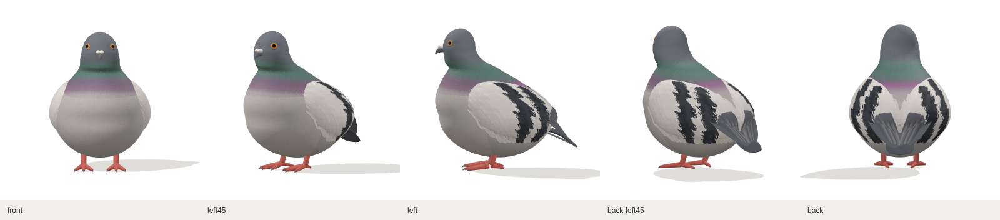
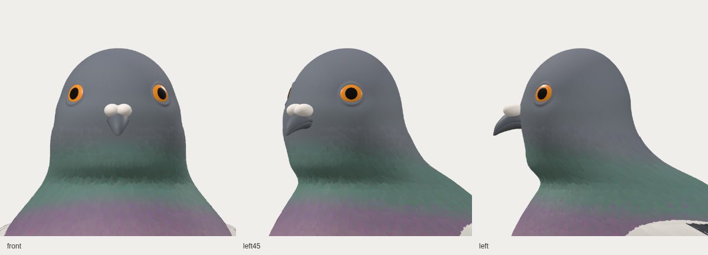
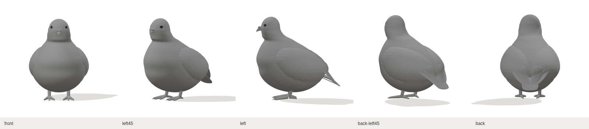
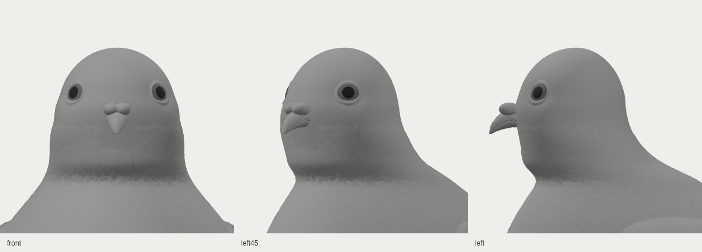

# R01 체형·겹깃 검토 · clay-v8

2026-10-30. 머리·아랫배·부리의 관계를 함께 수정하고, 같은 3D 모델에 실제 겹깃과 기본색을 추가했습니다. 아래 자료는 참고 이미지나 생성 이미지가 아닌, 포함된 GLB의 실제 웹 렌더입니다.





## 같은 형상의 무채색 확인





기본색/무채색은 같은 GLB에서 재질만 전환합니다. 카메라·조명·형상을 바꾸어 비교하지 않습니다.

## 실제 변경

- 둥근 정수리를 유지하면서 뒤통수와 볼·턱의 부피를 줄이고, 눈을 높였습니다. 눈은 표면에 더 얕게 묻고 검은 동공의 비율을 조정했습니다.
- 부리·납막을 함께 0.024H 높여 눈과의 간격을 줄이고, 부리 아래 목의 오목한 연결을 채웠습니다.
- 뾰족했던 아랫배를 타원체 곡률로 둥글게 닫고 몸통과 넓은 구간에서 연결해 단차를 없앴습니다. 다리 위쪽을 배에 묻고 발 간격·다리 굵기를 줄였습니다. 접힌 긴깃과 꼬리 끝도 짧고 둥글게 조정했습니다.
- 몸통을 감싸는 날개 어깨 위에 덮깃과 두 줄 무늬를 배치했습니다. 머리·목·가슴·날개·꼬리의 깃털은 얇은 메시가 실제로 겹치는 구조입니다.
- 머리는 넓은 비늘판처럼 보이던 형상을 가늘고 휘어진 깃결 조각으로 바꿨습니다. 목보다 촘촘하고 얕게 놓아 둥근 두상 위로 잔결이 흐르도록 구성했습니다.
- 주황 눈·산호색 발·회색 머리와 밝은 날개에 기본 PBR 색을 넣었습니다. 목의 청록·보라색은 연속 정점색으로 연결해 수평 띠 경계를 줄였습니다.

이 리비전은 메시 48개, 삼각형 132,654개, 깃판·깃결 조각 7,263개입니다. 머리의 가는 깃결 조각은 2,350개이며, 이를 개별 완성 깃털 수로 세지 않습니다. 이 수치는 제작 결과의 규모이며 외형 일치의 합격 점수가 아닙니다. 세부 수치와 해시는 [모델 생성 기록](model-report.json)을 따릅니다.

## 원본과 검증 자료

- [Blender 원본](https://github.com/poosuck/All_sorts_of_nonsense/blob/91e63aa2a185cd73acfaf1a9b33c4b4f039f8c8a/art/pigeon/pigeon.blend) · [GLB](https://github.com/poosuck/All_sorts_of_nonsense/blob/91e63aa2a185cd73acfaf1a9b33c4b4f039f8c8a/src/assets/pigeon/pigeon.glb) · [프로필](https://github.com/poosuck/All_sorts_of_nonsense/blob/91e63aa2a185cd73acfaf1a9b33c4b4f039f8c8a/art/pigeon/profiles.json) · [원본·GLB·프로필 해시](https://github.com/poosuck/All_sorts_of_nonsense/blob/91e63aa2a185cd73acfaf1a9b33c4b4f039f8c8a/src/assets/pigeon/manifest.json)
- [깃털 생성 소스](https://github.com/poosuck/All_sorts_of_nonsense/blob/91e63aa2a185cd73acfaf1a9b33c4b4f039f8c8a/scripts/pigeon-stage1/plumage.py) · [웹 렌더 기록](web-report.json)
- 웹 촬영 구성: 기본색 전신 8방향·얼굴 3방향, 무채색 전신 5방향·얼굴 3방향으로 총 19장입니다. 같은 모델을 로드한 상태에서 시점과 재질을 전환합니다.
- Blender 원본은 저장하지 않고 카메라만 이동해 [두상 3방향](head/head-three-views.png)을 별도 촬영했습니다. [촬영 기록](head/capture-record.json)의 원본·GLB 해시가 당시 manifest와 일치합니다.
- 이번 원본은 `PIGEON_MODEL_ONLY=1`로 생성해 Blender 전신 8방향 캡처를 별도 생성하지 않았습니다.
- 프로덕션 빌드, 단위 검사 13건, 푸딩 원본 일치 검사를 통과했습니다. 비둘기 프로덕션 E2E 4건도 통과했습니다. 웹 캡처 19장의 GLB 해시가 당시 manifest와 일치하며 모델 요청은 1회, 페이지 예외는 0건입니다.

최종 색 조정·미세 깃가지·목의 광학적 광택·리그와 7종 자세는 남아 있습니다. 시트 원본 파일이 없어 비율은 시각 추정값이며, R01과 완전히 일치한 완성 모델로 표시하지 않습니다.

## 로컬 확인

기록된 [clay-v8 커밋](https://github.com/poosuck/All_sorts_of_nonsense/tree/91e63aa2a185cd73acfaf1a9b33c4b4f039f8c8a)의 [ZIP](https://github.com/poosuck/All_sorts_of_nonsense/archive/91e63aa2a185cd73acfaf1a9b33c4b4f039f8c8a.zip)을 받아 압축을 푼 뒤 실행합니다.

```sh
npm ci
npm run dev
```

이전 모델을 대조하려면 위 고정 ZIP을 실행하고 http://localhost:5173/pigeon 에서 상단 **clay-v8**을 확인합니다. 최신 작업은 [clay-v9 기록](../clay-v9/README.md)을 따릅니다. **전신/얼굴**, **기본색/무채색**과 8방향 버튼으로 같은 모델을 대조할 수 있습니다. 일반 실행에는 Blender가 필요 없습니다. 이 변경은 작업 브랜치에 있으며 master 병합·Netlify 배포를 뜻하지 않습니다.
