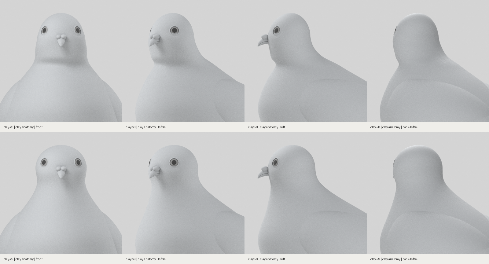
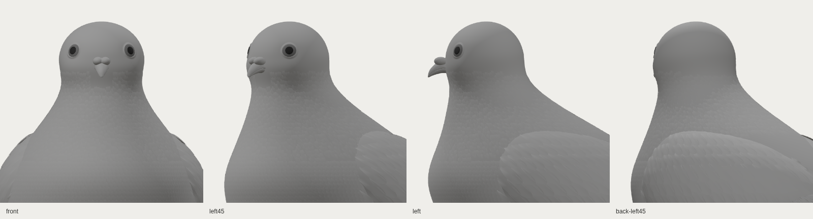
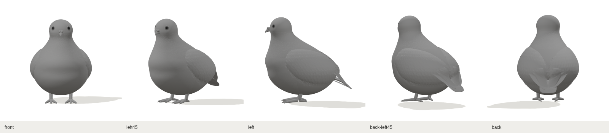

# 머리와 목·몸통 연결 검토 · clay-v9

2026-10-30. 색 작업을 멈추고 두상과 앞목·뒤통수의 연결을 수정했습니다. 기존 재질 설정과 부리 위치를 유지하며, 아래 비교는 무채색의 실제 3D 렌더입니다.

## 전후 형상



| 부위 | clay-v8에서 보인 문제 | clay-v9 변경 |
| --- | --- | --- |
| 턱 아래–앞목–가슴 | 앞목이 들어갔다가 다시 튀어나와 머리가 얹힌 인상 | 목 곡선을 가슴 위쪽까지 연결하고 패임을 완화 |
| 두개골 | 눈높이로 갈수록 계속 좁아지는 두상 | 눈높이에 둥근 부피를 만들고 바로 아래 목을 정리 |
| 뒤통수–등 | 머리에서 등으로 내려가는 흐름이 길고 단순함 | 뒤통수를 약간 뒤로 채워 목과 등으로 점진적으로 연결 |

이전의 짧은 .70H~.77H 연결 대신 .55H~.645H에서 본체와 목 곡선을 연결했습니다. 머리 폭을 늘리면서 눈의 물리적 간격이 과하게 벌어지지 않도록 눈 각도를 50°에서 44°로 조정했습니다. 수치는 제작 매개변수이며 시트 실측값이 아닙니다.

전후 촬영은 같은 카메라·조명·중립 재질·24샘플을 사용하고 `Plumage_*` 메시만 렌더에서 숨겼습니다. 본체 곡면은 촬영을 위해 변형하지 않았습니다. [v8 촬영 기록](before-anatomy/capture-record.json) · [v9 촬영 기록](head-neck-anatomy/capture-record.json)

## 깃털이 붙은 무채색 모델





[얼굴 3방향](web-clay-head-three-views.png)도 같은 GLB의 실제 웹 렌더입니다. 웹은 무채색으로 시작하며 **기존색**은 이전 재질을 확인하는 선택입니다. 이번 작업에서 색·광택을 추가하지 않았습니다.

## 원본과 검증 자료

- [Blender 원본](../../../../art/pigeon/pigeon.blend) · [GLB](../../../../src/assets/pigeon/pigeon.glb) · [프로필](../../../../art/pigeon/profiles.json) · [원본·GLB·프로필 해시](../../../../src/assets/pigeon/manifest.json)
- [모델 생성 기록](model-report.json) · [형상·변경 범위 확인](head-neck-audit.json) · [웹 촬영 기록](web-report.json)
- 웹 촬영 구성은 무채색 전신 8방향·얼굴 3방향·머리–목 4방향으로 총 15장입니다. 같은 모델을 로드한 상태에서 시점과 관찰 범위를 전환합니다.
- 원본은 `PIGEON_MODEL_ONLY=1`로 생성했습니다. Blender 전신 8방향 캡처는 별도로 생성하지 않았습니다.
- 프로덕션 E2E 4건을 통과했습니다. 무채색 웹 캡처 15장의 GLB 해시가 현재 manifest와 일치하며, 모델 요청은 1회·페이지 예외는 0건입니다.

[변경 범위 확인](head-neck-audit.json)에서 .55H 이하 몸통 정점 4,880개와 부리·발·꼬리·접힌 긴깃 외피의 위치, 재질 매개변수가 v8과 동일함을 확인했습니다. 상부 날개 뿌리와 깃털은 수정한 목·가슴 표면을 따릅니다. 곡면 연결 검사는 기울기의 연속성을 확인하며, 목표 외형의 합격 판정은 아닙니다.

현재 메시 48개, 삼각형 133,234개입니다. 크기와 기술 검사 결과는 R01 외형 일치의 합격 점수가 아닙니다. 머리·목의 형태를 계속 대조하는 단계이며 미세 깃가지·목 광택·리그·7종 자세는 남아 있습니다.

## 로컬 확인

[`codex/pigeon-clay-v1` 작업 브랜치](https://github.com/poosuck/All_sorts_of_nonsense/tree/codex/pigeon-clay-v1)의 [ZIP](https://github.com/poosuck/All_sorts_of_nonsense/archive/refs/heads/codex/pigeon-clay-v1.zip)을 받아 압축을 푼 뒤 실행합니다.

```sh
npm ci
npm run dev
```

http://localhost:5173/pigeon 에서 상단 **clay-v9**와 기본 **무채색**을 확인합니다. **머리·목** 버튼으로 두상부터 가슴·등까지 확대하며 http://localhost:5173/pigeon?frame=head-neck 으로 직접 열 수도 있습니다. 초기화하면 무채색 전신 기본 시점으로 돌아갑니다. 작업 브랜치의 변경이며 master 병합·Netlify 배포를 뜻하지 않습니다.
